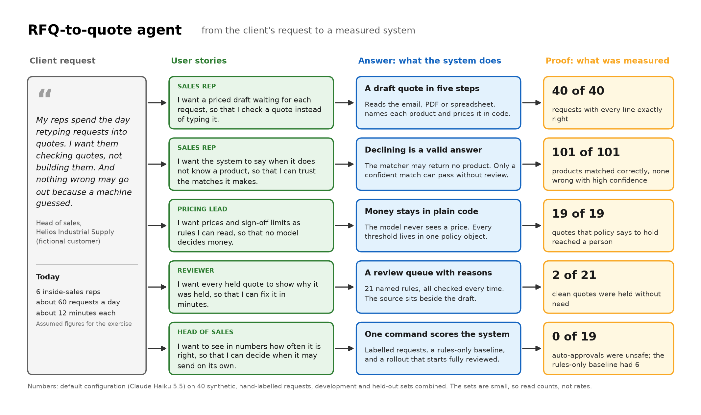

# Applied AI field projects

Complete projects that take a business workflow from discovery to a working, evaluated
AI system. The customers are fictional and the data is synthetic unless a project says
otherwise. Each one is built the way I would deliver it with a customer: understand
the work first, use a model only where it earns its place, measure it, and keep people
in the loop where mistakes cost money.
[How these projects are delivered](docs/delivery-method.md) describes the method on
one page.

The projects are presented, with my other work, at [burak-kiran.com](https://burak-kiran.com).

## Start here

- **Forward deployed engineering.** Read
  [RFQ-to-quote](projects/rfq-to-quote/README.md) for the path from a vague request to
  user stories, a system and measured results. Then read the
  [AML alert investigator](projects/aml-alert-investigator/README.md) for the same
  path in a regulated workflow, where the model works on pseudonymised data and a leak
  scan found no real identifier in anything sent to it.
- **Solution engineering.** Read the
  [impact model](projects/rfq-to-quote/README.md#13-impact-model) and the
  [rollout gates](projects/rfq-to-quote/README.md#12-rollout-plan-and-go-live-gates)
  of RFQ-to-quote. Then read the
  [evaluation](projects/revenue-incident-agent/README.md#11-evaluation) of the revenue
  incident agent, which reports a held-out result next to the tuned one.
- **Solution architecture.** Read the
  [revenue incident agent](projects/revenue-incident-agent/README.md), where a
  forecasting model and an agent share one system. Then read the AML alert
  investigator's [handling of bank data](projects/aml-alert-investigator/README.md#5-handling-bank-data)
  and its
  [model interface with a second-vendor adapter](projects/aml-alert-investigator/README.md#7-a-second-model-vendor),
  which is unit-tested and was never run against the live endpoint.

## From request to measured system

Every project begins with a map like this one, from RFQ-to-quote. It follows the
request in the client's words to the user stories it became, the part of the system
that answers each story, and the number that proves it.



## Projects

| Project | Industry | What it shows | Headline result | Stack |
|---|---|---|---|---|
| [RFQ-to-quote](projects/rfq-to-quote/) | Industrial distribution | Messy emails, PDFs and spreadsheets become priced draft quotes, with guardrails and a human review queue. | In its recorded run it got every line item right on 40 hand-labelled requests at about a tenth of a US cent each. Five further runs got 38 to 40 right, and one auto-approved a wrong cable size, which a size rule in code now holds. On a harder set of 32 requests written by a model, no model run approved a wrong quote. On a public benchmark the matching step scores F1 71.7%, against 31.4% for search alone; larger models reach 74.2% and 78.2%. | Python, Claude (structured outputs), SQLite FTS5, Streamlit |
| [AML alert investigator](projects/aml-alert-investigator/) | Banking | An agent works in a regulated workflow: pseudonymised data behind a privacy gateway, cited dispositions, tiered models, a spend cap, and a model interface with a second-vendor adapter that is unit-tested and was never run against the live endpoint. | It reached the right outcome on 38 to 40 of 40 alerts depending on the model configuration, against 22 for rules alone, with no suspicious alert closed in the recorded run or in nine repeat runs. 28 of the 40 alerts were used for tuning, and the tiered design did not beat a single model on this set. | Python, Claude (tool use), SQLite, Streamlit |
| [Revenue incident agent](projects/revenue-incident-agent/) | E-commerce | ML and an agent share one system: a forecasting model watches 706 series, an investigator names the cause with numbers that code recomputes, and an approved mitigation is executed once over HTTP against a mock admin service. | The detector finds 14 of 14 incidents on the development world and 5 of 7 on the held-out one. The agent names the right cause for 18 of 19 incidents, the scripted investigator for 16. Three repeat runs named 19, 19 and 18; one made an unsafe proposal that passed every check, which a check added since stops on replay. | Python, scikit-learn, DuckDB, Claude (tool use), FastAPI, Streamlit |
| [Tender radar](projects/tender-radar/) | Public procurement | A daily shortlist of EU public tenders on the live TED feed, scored against who went on to win: hard rules, ranking across 22 languages with a local embedding model, a model that reads the top of the list and quotes the notice, an append-only prediction log, a scheduled run and a scoreboard. | On a held-out month, 200 real suppliers went on to win 270 tenders. The list had 73% of them in its first three places, against 49% for the category alert. The model's own ranking gain did not hold on that month, and it marked 18 of 176 later-won tenders "skip"; the README says so. Live since 17 November 2026, with no outcomes yet. | Python, SQLite, scikit-learn, fastembed (local embeddings), Claude (structured outputs), Streamlit, GitHub Actions |
| [Issue triage desk](projects/issue-triage-desk/) | Software support | The first reader of new issues on a real public tracker, scored against what the maintainers later did: a classical classifier next to a model, duplicate search over 33,000 earlier issues with a local embedding model, a gate that holds when an issue addresses the model, shadow mode by default, an hourly run with a prediction log and a scoreboard. | On two held-out months (754 real issues, three runs) it proposed the right area for 412 to 419 of the 638 issues that have one, against 347 for the classifier and 206 for keyword rules. The model given only the label names did as well (443), one in four labels it would apply on its own is not what the maintainers applied, and their record proved too narrow to judge the duplicate step; the README says so. Live in shadow mode since 17 November 2026, with no outcomes yet. | Python, SQLite FTS5, scikit-learn, fastembed (local embeddings), Claude (structured outputs), Streamlit, GitHub Actions |
| [Edit moderation cascade](projects/edit-moderation-cascade/) | Trust and safety | A review queue ordered by risk on a live stream of Wikipedia edits, scored against which edits editors later reverted: a classifier on every edit with no request, a model on the riskiest fifth that returns three checked fields and no text, a bounded queue and a paced budget that turn overload into counted skips, a load test on a recorded slice of the stream, a prediction log and a scoreboard. | On two held-out days (1,500 real edits, 74 later reverted) the classifier alone put 14 of the 74 in the top 5% of the queue, against 4 for arrival order. The cascade with Haiku added two or three (16 to 17 over three runs), no more than a repeat run can produce, because the first tier passes on only 28 of the 74. Haiku on every edit, which the brief ruled out, did best (23) at US$0.16 per 1,000 edits; the README says so. On the live stream an edit the model reads is in the queue about four seconds after it was made. Two live runs on 17 November 2026, with no outcomes yet. | Python, scikit-learn, SQLite, Claude (structured outputs), Streamlit, GitHub Actions |

All six are built for teams inside a business. The first three are evaluated on small
sets. The tender radar, the issue triage desk and the edit moderation cascade are
evaluated on real outcomes from live public feeds. Each README says how far its
numbers can be trusted.

## Capabilities

A cell is filled where the project has that capability built and tested. Planned work
is not listed.

| Capability | RFQ-to-quote | AML alert investigator | Revenue incident agent | Tender radar | Issue triage desk | Edit moderation cascade |
|---|---|---|---|---|---|---|
| Document extraction | Emails, PDFs and spreadsheets into a typed schema | | | Conditions for tenderers from notices in the buyer's language, each with a quoted passage | | |
| Retrieval | Full-text search over a product catalog | | | Multilingual embeddings fused with category match | Word search and local embeddings fused, over 33,000 earlier issues, limited to what existed at the time | |
| Tool-using agent | | Investigator with evidence tools | Investigator with read-only tools | | | |
| Classical ML | | | Forecasting detector for anomalies | | TF-IDF and logistic regression per label, as a baseline and as a second opinion on the model | Gradient boosting on the stream event's own fields scores every edit and decides which edits the model reads |
| Privacy controls | | Pseudonymisation, field allow-lists, an outbound leak check | | Hashed supplier ids; no names, numbers or contact fields in committed files | No reporter or commenter fields read; issue text never committed; the demo runs on invented issues | No field for an account name in any record; edit summaries scrubbed; page text never committed; the demo runs on an invented wiki |
| Human review | Review queue; corrections become evaluation cases | A person approves every outcome | A person approves each mitigation before it runs | A bid manager marks bid or skip with a reason; the system never decides | A triage queue to accept, correct or reject each proposal; shadow mode until the numbers allow more | A review queue that shows the change with the lines the model marked; a reviewer marks each edit; the system never edits or reverts |
| Evaluation on outside data | Matching scored on a public benchmark, with three model sizes | | | 1,003 real outcomes from award notices, with a held-out month | 2,243 real issues scored against what the maintainers did, two months held out, three repeat runs | 91,628 real edits scored against which were reverted, two days held out, three repeat runs, the platform's own model as a reference line |
| Live data and operations | | | | A live public feed, a scheduled run, a prediction log scored when outcomes arrive, feed health checks, a daily spend cap | A live tracker, an hourly run, a prediction log scored fourteen days later, feed health checks, a daily spend cap | A live event stream with reconnect, a bounded queue with counted skips, a load test to 50 times the stream's rate, a prediction log scored 48 hours later, stream health checks, a daily spend cap spent evenly |

## What every project includes

- A one-page map from the client's request to user stories, the system and the
  measured results
- A component diagram and a decision flowchart near the top of its README
- A labelled evaluation set, a baseline that uses no model, and one command that
  scores the system and the baseline on that set
- A mode that runs without an API key, so anyone can clone and try it
- Written delivery documents: discovery notes, a workflow map, a plan, a decision log,
  an impact estimate
- Tests and CI

[Project standard](docs/project-standard.md) has the full list.

## Next

Three more projects are planned. None is finished, and none is in the tables above.
Each adds a shape the repository does not have yet:

- A docs support assistant, which will answer from a product's documentation with
  citations in a streaming chat page. It is built and tested, and its model answers
  are not recorded yet.
- An inference sizing kit, which will measure what a self-hosted model server sustains
  and then plan capacity and cost.
- An official letter explainer, a consumer app that will read a photographed letter
  and say what it asks for and by when.

## Running a project

Each project is self-contained and uses [uv](https://docs.astral.sh/uv/):

```bash
cd projects/rfq-to-quote
uv sync --all-extras
uv run pytest
```

To use a live model, copy `.env.example` to `.env` in the repository root and add
your key. `.env` is git-ignored.

## License

[MIT](LICENSE)
