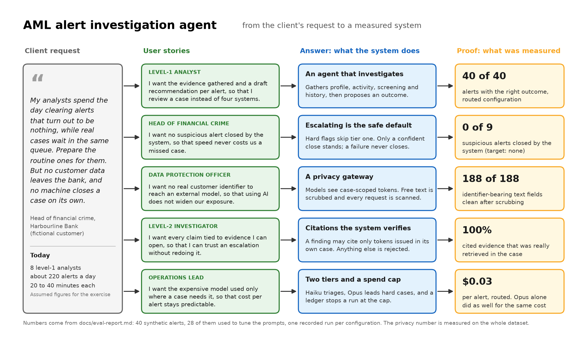
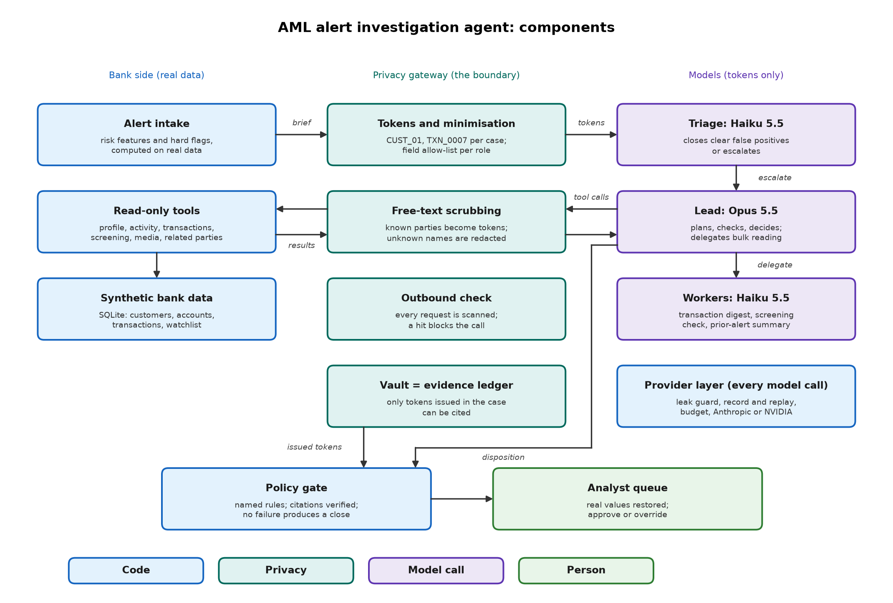
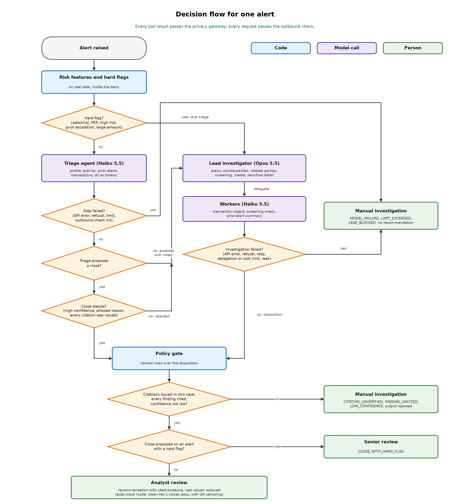
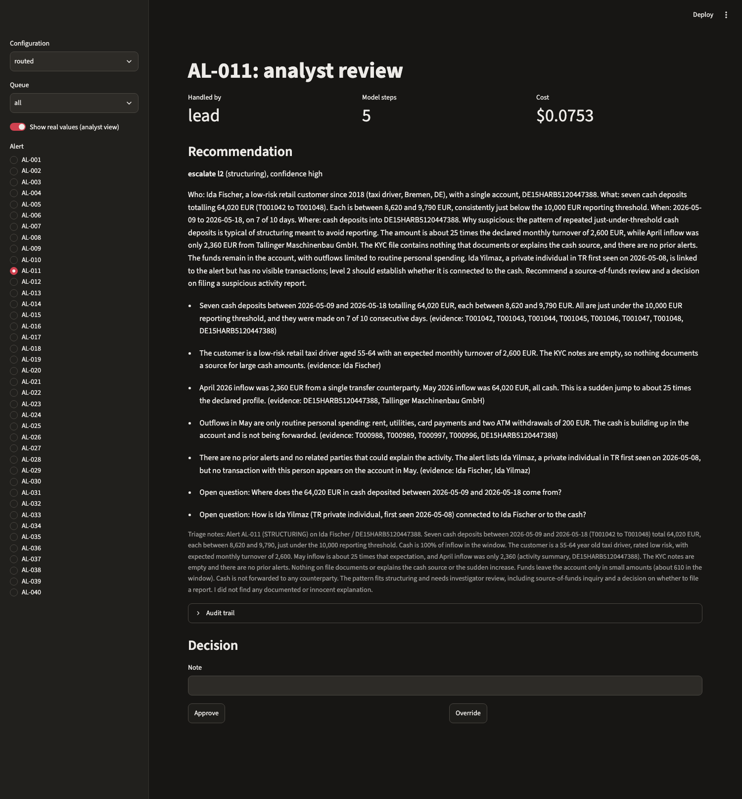

# AML alert investigation agent

An AI agent for the level-1 alert desk of a bank's financial-crime team. It takes an
alert raised by transaction monitoring, gathers the evidence an analyst would gather,
and proposes a disposition with cited evidence: close as a false positive, escalate
to level 2, or ask the relationship manager a question. A person approves every
outcome.

It is built the way a forward deployed engineer would deliver it: start from the
analysts' workflow, let a model investigate only where the work is open-ended, keep
numbers and policy in plain code, treat customer data as something the model must
never see in the clear, and measure everything against labelled cases.

**Status.** Built, tested, and run against the Claude API. Three model configurations are recorded on all 40 alerts and replay
without a key. None closed a suspicious alert, and the leak scan found no real
identifier in anything sent to a model. The whole project, development and
recorded runs together, cost $2.90 of API credit; nine repeat runs cost a further
$7.78.

| Configuration | Right outcome | Suspicious closed | Cost per alert |
|---|---|---|---|
| Rules only | 22 of 40 | 0 of 9 | none |
| Haiku in every role | 38 of 40 | 0 of 9 | $0.003 |
| Routed: Haiku triage, Opus lead | 40 of 40 | 0 of 9 | $0.032 |
| Opus alone, low effort | 40 of 40 | 0 of 9 | $0.030 |

Read these as a small synthetic benchmark, not a production claim: 28 of the 40
alerts were used to tune the prompts. The table shows the first recorded run. Each
model configuration was then run three more times
([per-run results](data/repeat-runs/)). Opus alone and the routed setup
got 40 of 40 every time, Haiku alone got 37, 38 and 37, and no run closed a
suspicious alert. Haiku was behind in every run, but three of its alerts changed
outcome from run to run, so the size of that gap is not settled. The routed design
is the one this project set out to build, and on this set it did not beat the
simpler single model in any run. [Evaluation](#10-evaluation) has the detail and
what did not go as designed.

**Contents:**
[The problem](#1-the-problem) ·
[How it works](#2-how-it-works) ·
[Decision flow](#3-decision-flow-for-one-alert) ·
[Worked example](#4-a-worked-example) ·
[Handling bank data](#5-handling-bank-data) ·
[Model routing](#6-model-routing) ·
[A second model vendor](#7-a-second-model-vendor) ·
[Guardrails](#8-guardrails) ·
[Failure handling](#9-failure-handling) ·
[Evaluation](#10-evaluation) ·
[Budget control](#11-budget-control) ·
[Human review](#12-human-review) ·
[Rollout](#13-rollout-impact-and-integration) ·
[Design decisions](#14-design-decisions) ·
[Run it](#15-run-it) ·
[Layout](#16-layout) ·
[Limits](#17-limits-and-next-steps)

## 1. The problem

> The customer is fictional ("Harbourline Bank") and the figures in this section are
> assumptions for the exercise, not measurements.

Harbourline's monitoring system raises about 220 alerts a day on rules such as
"cash deposits just under the reporting threshold" or "money leaves shortly after it
arrives". Eight level-1 analysts work them.

| Today | Detail |
|---|---|
| Most alerts are legitimate | A bonus, a property sale, a seasonal business. Each still has to be checked and written up |
| The work is gathering | An analyst opens four systems per alert: customer file, transaction history, name screening, case history |
| 20 to 40 minutes per alert | Most of it copying facts between systems, little of it judgement |
| Real cases wait | Suspicious alerts sit in the same queue as the routine ones |
| Two hard constraints | No customer data may leave the bank in the clear, and no machine may close a case on its own |

The request was turned into user stories during discovery
([discovery notes](docs/discovery-notes.md)). Each story maps to a part of the system
and to the number that shows whether it is met:



## 2. How it works



- **Alert intake (code).** Computes risk features on real data: cash deposits just
  under the threshold, the share of money that left within 48 hours, turnover
  against the declared profile. It also sets hard flags: a watchlist candidate, a
  politically exposed person, a high risk rating, a recent escalation, a large
  amount.
- **Privacy gateway (code).** Everything a model sees passes through it. Identifiers
  become case-scoped tokens, fields are cut to what the role needs, free text is
  scrubbed, and every request is scanned once more before it is sent.
- **Triage (Haiku 5.5).** A bounded tool loop with four read tools. It closes clear
  false positives with a reason code, or escalates with notes.
- **Lead investigator (Opus 5.5).** Handles what triage could not close and
  everything with a hard flag. It plans, checks counterparties, related parties,
  screening and adverse media, and hands bulk reading to workers.
- **Workers (Haiku 5.5).** One call each: digest raw transactions, compare a
  watchlist candidate, summarise earlier alerts. The lead reads digests, not rows.
- **Policy gate (code).** Named rules decide the review queue. A rejected output or
  a failure never becomes a close.
- **Analyst queue.** The case is shown with real values restored. The analyst
  approves or overrides.

## 3. Decision flow for one alert



## 4. A worked example

Alert `AL-011` in the dataset: seven cash deposits in ten days on a taxi driver's
account.

**What the model receives.** The brief, as tokens:

```json
{"alert": "ALERT_01", "rule": "STRUCTURING", "raised": "2026-05-19",
 "window_start": "2026-05-09", "window_end": "2026-05-18", "amount": 64020.0,
 "customer": "CUST_01", "account": "ACCT_01",
 "transactions": ["TXN_0001", "TXN_0002", "TXN_0003", "TXN_0004", "TXN_0005", "TXN_0006", "TXN_0007"],
 "counterparties": ["CPTY_03"]}
```

with figures computed in code:

```json
{"total_in": 64020.0, "cash_in_share": 1.0,
 "structuring": {"count": 7, "total": 64020.0, "band": [8000.0, 10000.0]},
 "turnover_ratio": 24.62}
```

and, when it asks for the customer profile:

```json
{"customer": "CUST_01", "kind": "retail", "age_band": "55-64", "occupation": "taxi driver",
 "country": "DE", "risk_rating": "low", "pep": false, "expected_monthly_turnover": 2600.0,
 "onboarded_year": 2018, "kyc_notes": "", "accounts": ["ACCT_01"]}
```

No name, date of birth, address or account number is in any of it. The model can
reason that seven deposits between 8,000 and 10,000 on an account that expects 2,600
a month look like structuring, and it can cite `TXN_0001` to `TXN_0007`.

**What the analyst sees.** The same case with tokens restored: the customer's name,
the IBAN and the real transaction references, next to the recommendation and its
evidence. Restoring happens only in the case viewer and in `aml-agent trace --reveal`.

**What the agent wrote.** From the recorded routed run: triage (Haiku, two steps)
could not explain the deposits and handed over; the lead (Opus, three steps)
checked the profile, the counterparty, the account history and earlier alerts, and
recommended escalation as structuring with high confidence. Two of its findings,
verbatim:

> Seven cash deposits between 2026-05-09 and 2026-05-18 totalling 64,020 EUR, each
> between 8,620 and 9,790 EUR. All are just under the 10,000 EUR reporting
> threshold, and they were made on 7 of 10 consecutive days.
> `[TXN_0001, TXN_0002, TXN_0003, TXN_0004, TXN_0005, TXN_0006, TXN_0007, ACCT_01]`

> April 2026 inflow was 2,360 EUR from a single transfer counterparty. May 2026
> inflow was 64,020 EUR, all cash. This is a sudden jump to about 25 times the
> declared profile. `[ACCT_01, CPTY_04]`

Every cited token was issued in this case, so the policy gate let the
recommendation through to the analyst's queue. The case cost $0.075.
`uv run aml-agent trace AL-011 --config routed` replays it without a key.

## 5. Handling bank data

The models never see a real identifier. They work on pseudonymised case data, and
real values are restored only on the bank's side.

| Control | Behaviour |
|---|---|
| Pseudonymisation | Names, IBANs, customer and account numbers, emails and phones become tokens such as `CUST_01` or `CPTY_04`. Transactions and earlier alerts get tokens too. The mapping is per case, so two cases cannot be joined from their traces |
| Minimisation | Each role has a field allow-list. Date of birth becomes an age band. Triage sees fewer fields than the lead |
| Free-text scrubbing | Known parties in descriptions and notes become tokens, in any case and also when only a surname appears. IBANs, phone and card numbers are caught with spaces, hyphens or dots in them. The bank's own ids become tokens. Any other capitalised word that is not ordinary vocabulary is redacted, so an unknown name fails closed |
| Sensitive categories | Counterparties tagged health, religion, political or trade union are withheld by default |
| Need-to-know | The lead can request the category of a withheld counterparty with a written justification. The request is logged and shown to the analyst |
| Screening inside the boundary | Name screening runs in code on real names. The model receives comparison facts: name similarity, date-of-birth match, country match |
| Outbound check | A wrapper around every model provider scans each request for real identifiers and blocks the call on a hit |

**The evidence ledger.** Every identifier the model sees is a token the gateway
issued in that case, so the vault doubles as a ledger. A finding may cite only
tokens that were shown to the model that cites them: in its brief, in a tool
result, or in a worker's digest. A token that was issued in the case but shown only
to another model does not count, and the policy gate rejects the disposition. The
check proves the evidence was retrieved. It does not prove the evidence supports
the statement; that judgement stays with the analyst, who can open each item.

**Measured.** 188 free-text fields in the dataset hold an identifier,
including names planted in free text that are in no entity table. After scrubbing,
none does. A leak scan reads everything that was sent to a model in the three
recorded runs and finds no real identifier; it runs in CI.

**Stated limits.** Pseudonymised data is still personal data: this reduces exposure,
it does not make the data anonymous. Vocabulary-based scrubbing can over-redact, and
an unknown name written in lower case would pass both the scrubber and the outbound
check, because neither has ever seen it. The measurement above covers the
identifiers the bank knows plus names planted in free text, not that case. These are engineering controls on synthetic data, not a legal
compliance claim. More in [data-protection.md](docs/data-protection.md).

## 6. Model routing

| Role | Model | Effort | Tools | Limits |
|---|---|---|---|---|
| Triage | `claude-haiku-5-5` | low | profile, activity summary, prior alerts, transactions | 6 model steps |
| Lead | `claude-opus-5-5` | medium | all read tools, sensitive detail, delegate | 8 model steps, 6 delegations |
| Worker | `claude-haiku-5-5` | low | none; one call returning a typed digest | one call |

Most alerts are routine, and at list prices an Opus token costs 40 times a Haiku
token. So the small model sees every alert that has no hard flag, and the large one
sees only what is left. The lead can delegate bulk reading to workers to keep its
context small. That is the design; [the evaluation](#10-evaluation) measured it
against one large model on every alert, and the simpler setup did as well.

In the recorded runs the lead never delegated. No account in this dataset holds more than
100 transactions, and the lead read them itself in one or two calls. So the worker
path is proven by unit tests and by one live call per worker type, not by the
evaluation; it would matter on accounts with thousands of rows, which this dataset
does not have.

Routing is decided in three places, none of them a prompt alone: code sends any
alert with a hard flag straight to the lead; triage may escalate; and code rejects
a triage close that is not high-confidence, uses a reason code not allowed at tier
one, or cites evidence that was never retrieved.

Model and effort per role are configuration, so the evaluation compares assignments
without code changes.

## 7. A second model vendor

The agent loop talks to one interface: `step(request) -> response` over plain data.
Claude is one implementation. An NVIDIA-hosted model is another: the NVIDIA API
catalog exposes an OpenAI-compatible chat endpoint, and `nim.py` translates the
step format to chat completions and back.

That endpoint does not guarantee that tool arguments match the schema, and
structured output differs by backend. The provider therefore relies on neither. A
requested schema is stated in the prompt, and validation sits where it protects
both vendors: the tool layer rejects bad arguments, the loop re-prompts once on an
inconsistent submission, and workers check their digests.

The same leak guard, recording and replay wrap both vendors, and the `nim`
configuration puts the NVIDIA-hosted model in every role under the same evaluation.

**This path has not been run against the live endpoint.** No NVIDIA key was used
for this repository, so it has no recording and no result. What is checked is the
translation: unit tests cover the request and reply conversion, malformed tool
arguments, the request cap and endpoint errors, all against the documented format.
Whether a given hosted model calls tools reliably is unknown until someone runs it.
With a key, `aml-agent nim-check --yes` asks candidate models for one tool call
each, and `aml-agent run --config nim --live --record` records the run.

## 8. Guardrails

Each reason for routing a case is a rule with a code and a sentence the analyst
reads. Thresholds live in one `Policy` object.

| Rule | Effect |
|---|---|
| `CITATION_UNVERIFIED` | A finding cites evidence the model that wrote it was never shown in this case: manual investigation |
| `FINDING_UNCITED` | A finding has no evidence: manual investigation |
| `LOW_CONFIDENCE` | The agent called its own conclusion a guess: manual investigation |
| `CLOSE_WITH_HARD_FLAG` | A close is proposed on a flagged alert: senior review |
| `LIMIT_EXCEEDED` | Step, delegation or cost limit reached: manual investigation |
| `MODEL_FAILURE` | API error, refusal or unusable output: manual investigation |
| `LEAK_BLOCKED` | The outbound check stopped a request: manual investigation |
| `SENSITIVE_ACCESS_USED` | Informational flag on the case |
| `TRIAGE_CONFIDENCE`, `TRIAGE_REASON_NOT_ALLOWED` | A tier-one close does not stand: the alert goes to the lead |
| `QA_SAMPLE` | An automatic close sampled into analyst review |
| `INSTRUCTION_IN_DATA` | Free text in the bank's data reads like an instruction to the model: manual investigation, whatever the model proposed |
| `INTERNAL_ERROR` | The agent itself failed on the case: manual investigation, and the run continues |

Queues: `analyst_review` (a recommendation is attached), `senior_review`,
`manual_investigation` (no recommendation is trusted), `auto_closed`.

**Assisted mode** is the default: every disposition is a recommendation. An
**auto-close** mode lets a clean tier-one close go through, with a fixed share
sampled for quality checks. It exists so the evaluation can show what it would
have closed before anyone turns it on.

The agent has no write tool. It cannot file a report, block an account or contact
a customer.

**Text that tries to steer the model.** A payment reference or a customer note is
written by someone outside the bank's control, and the model reads it. The control
is in code, not in the prompt: the gateway checks every free-text field for text
written to the model (talk of instructions or prompts, this system's tool names
and output fields), and one hit sends the case to manual investigation, so such an
alert is never closed automatically and the model's recommendation is not relied
on. Nothing in the dataset triggers it, so the recorded results are unchanged. Its
limit is stated in [section 17](#17-limits-and-next-steps).

## 9. Failure handling

| Failure | Behaviour |
|---|---|
| API error, rate limit, timeout after SDK retries | `MODEL_FAILURE`, manual investigation |
| Refusal | Opus: server-side fallback, then `MODEL_FAILURE`. Haiku: `MODEL_FAILURE` |
| The model ends without submitting | One re-prompt, then `MODEL_FAILURE` |
| Inconsistent submission (a close without a reason code, an escalation without a narrative) | One retry, then `MODEL_FAILURE` |
| Tool arguments that do not fit, unknown token, bad date | Error result returned to the model so it can correct itself |
| A tool crashes | Error result returned to the model |
| A worker fails | Error result to the lead, which may proceed without it. A worker call that was paid for stays in the case's cost and audit trail even if its reply was unusable |
| A live call fails while recording | The failure is recorded too, so the run replays exactly; a later live run retries it |
| An unexpected error in one case | `INTERNAL_ERROR`, manual investigation; the other cases finish |
| Budget reserve reached | The run stops cleanly; finished cases are kept |
| Outbound check hit | `LEAK_BLOCKED`, manual investigation |

No failure produces a close.

## 10. Evaluation

One command scores every configuration and writes
[docs/eval-report.md](docs/eval-report.md). Scoring is done in code against gold
labels; there is no LLM judge.

The alert set is synthetic: 40 alerts from a seeded generator, 28 for development
and 12 held out, 9 of them suspicious. Labels are true by construction, because the
generator planted each pattern. The set is deliberately enriched with hard cases,
so its shares are not what a production queue looks like.

The held-out set is a weak test, and the results should be read with that in mind:

- 8 of its 12 alerts are labelled clear.
- Every held-out alert comes from a scenario template that also produced
  development alerts, with different random values. None is a new kind of case.
- Six scenarios exist only in the development set: the clinic patient, the club
  treasurer, layering, profile mismatch, high-risk jurisdiction and property sale.
- Every configuration got all 12 held-out alerts right in every run. So every
  difference between configurations on this page sits on development alerts,
  which are the ones the prompts were tuned on.

It shows that the prompts were not fitted to particular random values. It does not
show how the agent handles a kind of case it has not seen.

| Metric | Question it answers |
|---|---|
| Suspicious closed | Gold says escalate and the system recommended a close. The unsafe error; the target is zero |
| Under-escalated | An unsafe close made at tier one |
| Over-escalated | A clear, unflagged alert that reached the lead: wasted spend |
| Outcome and typology accuracy | Against gold labels |
| Evidence recall | Share of the key evidence a good write-up must cite |
| Valid citations | Share of cited tokens the gateway really issued |
| Leakage | Real identifiers found in anything sent to a model |
| Cost, steps, latency | Per alert and per tier |

Expected routing is derived from the labels and the policy, not hand-labelled, so
it does not go stale when a threshold changes.

**Measured: the rules-only baseline.** It answers "does this need a model at all?"

| Set | Alerts | Suspicious closed | Outcome accuracy | Typology |
|---|---|---|---|---|
| Development | 28 | 0 | 57% | 83% |
| Held-out | 12 | 0 | 50% | 100% |

Rules alone are safe here and wasteful. They escalate every suspicious alert, and
they also escalate 18 of 31 legitimate ones: every bonus, every seasonal business,
every documented sale and both false watchlist matches. Those are exactly the cases
that are settled by reading the customer file, which rules cannot do. The baseline
also names the layering case as a profile mismatch.

**Measured: three model configurations**, one recorded run each on all 40 alerts.

| | Rules only | Haiku in every role | Routed (Opus lead) | Opus alone |
|---|---|---|---|---|
| Right outcome, development (28) | 16 | 26 | 28 | 28 |
| Right outcome, held-out (12) | 6 | 12 | 12 | 12 |
| Suspicious alerts closed (9) | 0 | 0 | 0 | 0 |
| Typology right, of 9 suspicious | 8 | 8 | 8 | 9 |
| Key evidence cited | 73% | 95% | 95% | 95% |
| Valid citations | 100% | 100% | 100% | 100% |
| Closed at tier one | none | 15 | 16 | no tier one |
| Model steps per alert | none | 3.8 | 3.3 | 2.3 |
| Cost per alert | none | $0.003 | $0.032 | $0.030 |
| Total for 40 alerts | none | $0.10 | $1.29 | $1.21 |

"Routed" is the design this project set out to build: Haiku triage, Opus lead at
medium effort. "Opus alone" is the simpler alternative: Opus at low effort on every
alert, with no first tier.

What the numbers say:

- **The safety target held.** No configuration recommended closing a suspicious
  alert. Three closes on alerts with a hard flag were sent to senior review by the
  policy gate, as designed.
- **Reading the file is what the model adds.** Every model configuration closes
  the bonuses, sales and seasonal businesses that the rules escalate.
- **Routing did not earn its complexity here.** Opus alone matched the routed
  configuration on every outcome, named all nine typologies, took fewer steps and
  cost slightly less. The routed lead runs at a higher effort and its triage tier
  closed only half of the legitimate alerts, so the cheap tier saved less than the
  expensive tier spent.
- **Haiku alone is the cheap option, one tenth of the cost.** It missed two
  legitimate, hard cases (a club treasurer and a clinic patient) by asking for
  more information, which is a safe error.
- **Opus alone did less work per alert.** Its average evidence coverage equals
  the others, but on two pass-through cases it cited half or less of the
  transactions a good write-up should cite, and it closed the clinic case without
  asking for the withheld category.
- **So the recommendation changed.** Take Haiku alone or Opus alone into shadow
  mode, depending on what a missed close costs in analyst time, and keep the
  routed setup only if real alerts show a split that pays. A routed setup with the
  lead at low effort is the obvious next thing to measure; it was not run.

What to hold against them:

- **Small and synthetic.** 40 alerts, 9 suspicious, patterns planted by a
  generator. Real notes are messier and real hard cases are harder. Differences of
  one or two alerts between configurations are within noise.
- **The development set was tuned on.** Three live rounds on the 28 development
  alerts shaped the prompts, and one scenario's data was corrected after the first
  round ([decision 19](docs/decision-log.md)). The 12 held-out alerts were first
  run in the recorded runs.
- **Four runs per configuration, still a small sample.** Three repeat runs gave
  the same outcome on every alert for Opus alone and for the routed setup. Haiku
  alone changed its outcome on three legitimate alerts between runs. Triage sent
  10 of the 40 alerts to a different tier in at least one routed run, which moved
  that run's cost between $1.11 and $1.42 without changing an outcome. The leak
  scan was clean on all nine. The scored result of every run, per run and per
  alert, is in [data/repeat-runs/](data/repeat-runs/). The repeat recordings
  themselves are 11 MB and are not in the repository, so those rows are a summary
  and cannot be re-derived here; section 15 has the command that records a run.
- **Found while running live:** the outbound check blocked one case on a false
  alarm, an amount followed by a date read as a phone number. The case went to
  manual investigation, which is the designed failure. The pattern is fixed and
  tested. A repeat run then met a second false alarm of the same kind: a range
  written as "8000-10000" in a hand-off note was read as a phone number. It also
  failed closed. This one is not fixed yet.

**Not measured.** The NVIDIA-hosted configuration (section 7).

## 11. Budget control

- Live calls are opt-in (`--live`); saving responses is a second flag (`--record`).
- A spend ledger records the cost of every live call, cache reads and writes
  included. Before each call the run stops if the remaining budget is below a
  reserve for that call. The reserve is an upper bound on what the call can cost:
  the size of the request about to be sent, counted at one input token per byte
  (which over-counts), plus the output limit, at the highest price the call can be
  billed at. Calls in flight hold their reserves at the same time, so parallel
  cases cannot pass the cap together. A damaged ledger stops the run instead of
  counting as zero. One gap remains: when the API declines a request and a
  fallback model answers, the declined attempt is not written to the ledger.
- Each case has its own cost limit, which routes it to a person when reached.
- Recorded runs replay for free and without a key. A changed prompt is a miss, never
  a stale answer.
- The NVIDIA trial tier is not priced per token; it is guarded by a request cap and
  a minimum interval between calls.

## 12. Human review

`uv run streamlit run app/case_viewer.py` opens the analyst's view: the queue, the
recommendation with real values restored, the rules that fired, any sensitive-detail
request, the full audit trail (every model step, tool call and result), and approve
or override with a note. Decisions are stored. A link such as
`?config=routed&alert=AL-011` opens one case.



*The worked example from section 4 as the analyst sees it. Every name and account
number on screen is synthetic.*

## 13. Rollout, impact and integration

- [Project plan](docs/project-plan.md): a four-week plan with gates, then shadow
  mode, assisted mode, and auto-close for the lowest-risk class only if the numbers
  support it.
- [Impact estimate](docs/impact-estimate.md): a simple model with stated assumptions.
- [Workflow map](docs/workflow-map.md): the analysts' steps before and after.

Integration points in a real deployment: the case management system (alerts in,
dispositions out), a read replica of core banking for the tools, the bank's
screening provider behind `screen_party`, and model access through the bank's
approved channel, which is one class behind the provider interface.

## 14. Design decisions

The full list with alternatives and trade-offs is in
[docs/decision-log.md](docs/decision-log.md). The ones that shaped the system:

- An agent loop here, a fixed pipeline in [rfq-to-quote](../rfq-to-quote/): an
  investigation has no fixed shape, a quote does.
- Code computes, models interpret.
- Pseudonymise at a gateway instead of trusting the model with raw data.
- The token vault is also the evidence ledger.
- Scrubbing fails closed on unknown names.
- A hand-written loop, because every model step has to be recorded, replayed,
  budget-checked and leak-scanned.
- Tool calls run in order, so token numbers and replays are deterministic.
- Scoring in code, not by a model.

## 15. Run it

```bash
cd projects/aml-alert-investigator
uv sync --all-extras
uv run pytest

# Investigate every alert with the rules-only baseline (no key needed)
uv run aml-agent run --config baseline

# The audit trail of one case, as the model saw it and as the analyst sees it
uv run aml-agent trace AL-011 --config baseline
uv run aml-agent trace AL-011 --config baseline --reveal

# Score every configuration and write docs/eval-report.md
uv run aml-agent eval

# Scan every recording for real identifiers
uv run aml-agent leak-check

# The analyst's case viewer
uv run streamlit run app/case_viewer.py
```

With a key in the repository-root `.env` (`ANTHROPIC_API_KEY`; `NVIDIA_API_KEY`
only if you want to try the NVIDIA-hosted configuration):

```bash
# One alert, live, with a spend cap for the run
uv run aml-agent run --config routed --alert AL-011 --live --max-usd 0.60

# A full recorded run; later runs replay it for free
uv run aml-agent run --config routed --live --record --max-usd 2.80

# What live runs have cost so far
uv run aml-agent budget
```

Rebuild the dataset or the diagrams:

```bash
uv run python scripts/build_dataset.py
uv run python scripts/render_flow.py
uv run python scripts/render_flowchart.py
uv run python scripts/render_request_to_system.py
```

## 16. Layout

```
src/amlagent/
  models.py      typed data: alert, disposition, trace
  bankdb.py      the synthetic bank, loaded into SQLite
  features.py    risk features, name screening, hard flags
  privacy.py     token vault, gateway views, scrubber, outbound check
  tools.py       read-only tools and their strict schemas
  llm.py         provider interface, Claude, record and replay, leak guard, router
  nim.py         NVIDIA-hosted model provider
  budget.py      spend ledger
  agent.py       the bounded tool loop
  roles.py       model per role, prompts
  workers.py     the three worker digests
  policy.py      thresholds, named rules, gate
  pipeline.py    one alert end to end
  baseline.py    rules-only configuration
  store.py       cases, vaults, analyst decisions
  evals.py       scoring and report
  cli.py
app/case_viewer.py
scripts/         dataset generator and the three diagram scripts
data/            core/*.csv, alerts/, gold/, cassettes/, repeat-runs/
docs/            design, discovery notes, plan, decision log, data protection, report
tests/
```

## 17. Limits and next steps

- **Synthetic data is cleaner than real data.** Planted patterns are easier to see
  than real ones, and real KYC notes are messier. The first step with a customer is
  labelling real closed alerts with the analysts.
- **The evaluation set is small.** Forty alerts show whether the system is wired
  correctly and where it fails; they cannot bound a rare error rate. Read counts,
  not percentages.
- **Scrubbing is vocabulary-based.** An unknown name in lower case passes it. A
  production gateway would add a name recogniser that runs inside the bank.
- **Injected instructions are caught by pattern only.** The check for text
  written to the model is a list of patterns. The same request in other words
  passes it, and the prompts do not tell the model that free text is untrusted,
  because changing a prompt would invalidate the recordings. What still holds for
  a paraphrased attempt: hard flags are computed in code and send the alert to the
  lead, a close on a flagged alert needs senior review, and in assisted mode a
  person decides every case. Auto-close mode is the exposed one: a steered
  tier-one close at high confidence would go through. Before auto-close is turned
  on, the prompts should mark free text as data and the check should be tested
  against a red-team set.
- **A valid citation is not a supported claim.** The gate checks that cited
  evidence was shown to the model, not that it backs the statement.
- **No network analytics.** Related parties come from a link table; there is no
  graph search across the customer base.
- **The workers did not run in the evaluation.** The lead never needed them on
  accounts this small.
- **The structuring alerts list a counterparty whose transfers are booked after
  the alert date.** The tools hide those transfers, as they should, and the
  write-ups note the link as unexplained. It is a flaw in the generator.
- **The NVIDIA-hosted path is untested against the live endpoint.** The adapter is
  covered by unit tests only; expect to adjust it on first contact. The endpoint it
  targets is a trial tier meant for development.

## More detail

[Design](docs/design.md) · [Discovery notes](docs/discovery-notes.md) ·
[Workflow map](docs/workflow-map.md) · [Project plan](docs/project-plan.md) ·
[Decision log](docs/decision-log.md) · [Data protection](docs/data-protection.md) ·
[Impact estimate](docs/impact-estimate.md) · [Evaluation report](docs/eval-report.md)
