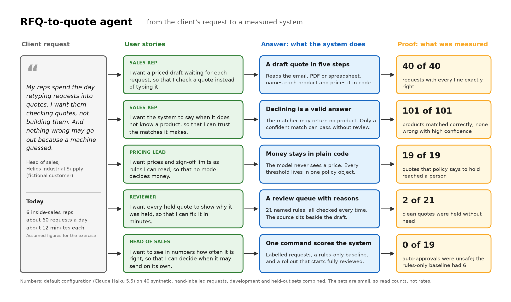
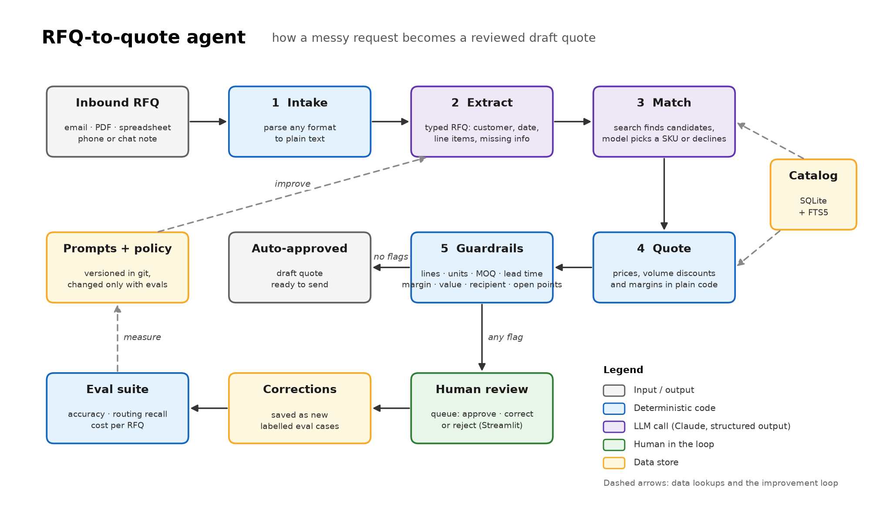
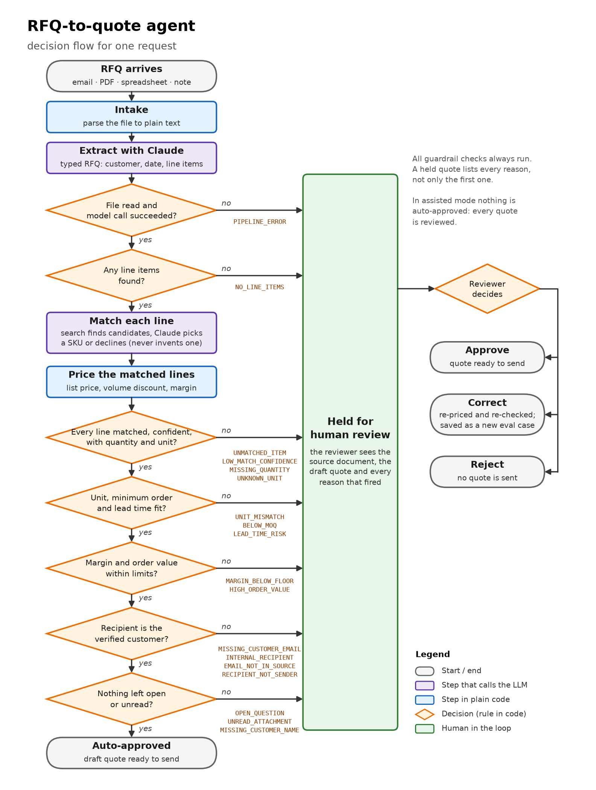
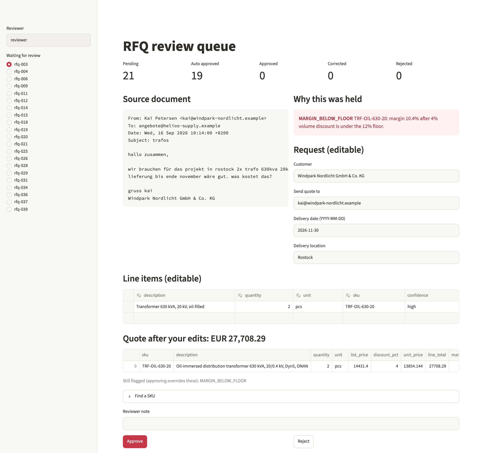

# RFQ-to-quote agent

An AI agent for the inside-sales desk of an industrial materials supplier. It reads
messy inbound requests for quotation (emails, PDFs, spreadsheets, phone notes, in
German or English), turns them into priced draft quotes, and decides which ones may
go out and which a person must check first.

It is built the way a forward deployed engineer would deliver it: start from the
business workflow, use an LLM only where language has to be interpreted, keep money
decisions in plain code, measure everything against labelled cases, and put a human
in the loop wherever a mistake costs money.

**Status.** Complete and measured. In its recorded run on 40 hand-labelled
requests the default configuration (Claude Haiku 5.5) got every line item right,
held every quote that policy says a person must see, and auto-approved nothing it
should not have, at about a tenth of a US cent per request. Five further live runs
show how much that moves: every line was right on 38 to 40 of the 40 requests, and
in one run a cable size the catalog does not carry was matched to its neighbour and
auto-approved. A size check in code now holds that quote, and replayed through it
none of the recorded runs has an unsafe approval. On a harder set of 32 requests
whose texts a model wrote, rules alone got no request right; with the default
prompt, every recorded run of three Claude models got 95 or 96 of the 96 lines
right and auto-approved nothing it should not have. That set does not tell the
three models apart. The sets are small and synthetic;
section 9 says how far those numbers can be trusted. On a public benchmark the
author did not write, the unchanged matching step scores F1 71.7%, and about one in
eight of its high-confidence picks is wrong by that benchmark's labels. Two larger
models find more of the matches there and are no safer: about one in eight of
their high-confidence picks is wrong too. 157 tests.

**Contents:**
[The problem](#1-the-problem) ·
[How it works](#2-how-it-works) ·
[Decision flow](#3-decision-flow-for-one-request) ·
[Worked example](#4-a-worked-example) ·
[Guardrails](#5-guardrails) ·
[Where the LLM is used](#6-where-the-llm-is-used-and-where-it-is-not) ·
[Failure handling](#7-failure-handling) ·
[Security and data](#8-security-and-data) ·
[Evaluation](#9-evaluation) ·
[Human review](#10-human-review-and-the-feedback-loop) ·
[Operations](#11-operations) ·
[Rollout](#12-rollout-plan-and-go-live-gates) ·
[Impact](#13-impact-model) ·
[Integration](#14-integration-points) ·
[Design decisions](#15-design-decisions) ·
[Run it](#16-run-it) ·
[Layout](#17-layout) ·
[Limits](#18-limits-and-next-steps)

## 1. The problem

> The customer is fictional ("Helios Industrial Supply") and the figures in this
> section are assumptions for the exercise, not measurements.

Helios sells cables, transformers, solar mounting hardware and accessories. Six
inside-sales reps produce about 60 quotes a day from a shared inbox.

| Today | Detail |
|---|---|
| Handling time | About 12 minutes per request: read it, look up each product in the ERP, retype quantities, apply the discount table, check lead time |
| Where the time goes | Product lookup first ("half of what I do is translating what the customer calls it into what we call it"), then retyping |
| Typical errors | Wrong cross-section (5x2.5 against 5x25), 10 kV against 20 kV, drums quoted as metres, thousands separators misread |
| Sign-off | Quotes over EUR 50,000 or under 12% margin need the pricing lead, but only if the rep notices |

The work splits cleanly, and the design follows the split:

- **Reading the request and naming the products** is language work with high
  variance. This is where an LLM helps.
- **Pricing, discounts, minimum quantities, lead times and sign-off limits** are
  rules the business already has. They belong in code the pricing lead can read.
- **Judgement on unclear or risky requests** stays with people, who must be shown
  why a request reached them.

Success criteria agreed with the (fictional) head of sales:

1. A rep spends minutes checking a draft instead of building a quote.
2. No quote goes out automatically with a wrong product, quantity or recipient.
   Missing a risky quote is worse than holding a safe one.
3. Every held quote states the reason.
4. The desk can see in numbers how often the system is right before it is allowed
   to send anything on its own.

**From request to system.** Discovery turned the request into five user stories.
Each one is answered by a named part of the system and checked by a number from
the evaluation (section 9). The stories are written out in the
[discovery notes](docs/discovery-notes.md#user-stories).



## 2. How it works



| Step | What happens | LLM? | Code |
|---|---|---|---|
| 1. Intake | Email (with attachments), PDF, spreadsheet or text note is parsed to plain text | No | `intake.py` |
| 2. Extract | Claude fills a typed schema: customer, delivery date and place, line items, open questions | Yes | `extract.py` |
| 3. Match | Full-text search over the catalog finds up to 8 candidates per line; Claude picks one or declines | Yes | `catalog.py`, `match.py` |
| 4. Quote | List price, volume discount and margin from catalog data | No | `quote.py` |
| 5. Guardrails | Named rules decide: auto-approve, or hold for a person with every reason | No | `guardrails.py` |
| Review | A reviewer approves, corrects or rejects; corrections become new eval cases | Human | `app/review_ui.py`, `store.py` |

Pricing is deliberately simple: list price from the catalog, with a volume discount
by line value (2% from EUR 5,000, 4% from EUR 20,000, 6% from EUR 50,000). Margin
is computed against catalog cost.

## 3. Decision flow for one request



Every diamond is a rule in code, not a model judgement. All rules always run, so a
held quote lists every reason and not only the first one.

## 4. A worked example

A contractor writes: *"we need pricing for 1.2 km of NA2XS(F)2Y 1x150 RM/25
12/20 kV and 6 sets of matching outdoor terminations (heat-shrink, 24 kV).
Delivery in calendar week 44."*

| Step | Result |
|---|---|
| Extract | Customer and email from the signature; delivery 2026-10-26 (Monday of week 44); line 1: 1200 m of the cable ("1.2 km" converted); line 2: 6 pcs terminations |
| Match | Line 1 matches `CAB-MV-1X150-20KV` (the catalog also has a 10 kV version). Line 2 has no match: the catalog has no terminations, and declining is the correct answer |
| Quote | 1200 m at EUR 12.78 list, 2% volume discount, EUR 15,029.28, 14.25% margin, 20 days lead time |
| Guardrails | Margin, value, minimum quantity and lead time pass. `UNMATCHED_ITEM` fires on line 2 |
| Route | Held for review. The rep sees the email next to the draft and the reason, and decides how to answer on the terminations |

All of this is recorded output of the default configuration. The one thing it
missed is the delivery location, which it left empty for "near Bremen". The
rule-based baseline finds no line items in this email at all.

## 5. Guardrails

A quote is auto-approved only if no rule fires. Thresholds live in one `Policy`
object in `guardrails.py`.

| Reason code | Fires when | Why it exists |
|---|---|---|
| `PIPELINE_ERROR` | The file could not be read or the extraction call failed | No request is ever dropped |
| `NO_LINE_ITEMS` | Nothing to quote was found | May not be an RFQ; a person should read it |
| `MISSING_QUANTITY` | A line has no quantity | Cannot be priced |
| `UNKNOWN_UNIT` | A line has a quantity but no unit | 150 drums and 150 m are different orders |
| `UNMATCHED_ITEM` | No catalog product fits, the model declined, the model named a SKU outside the candidates, matching failed, or the request has more than 80 lines | The agent does not guess products |
| `LOW_MATCH_CONFIDENCE` | The match is anything other than "high" | The model had to assume something the customer did not say |
| `SIZE_MISMATCH` | The request states a size such as 4x16 and the matched product has a different one | A repeat run matched a size the catalog does not carry to its neighbour, with high confidence (section 9) |
| `UNIT_MISMATCH` | Requested unit differs from the unit the product is sold in | For example two drums of a cable sold per metre |
| `BELOW_MOQ` | Quantity is under the product's minimum order | Business rule |
| `LEAD_TIME_RISK` | Requested date is earlier than the processing date plus the longest lead time on the quote | We would promise a date we cannot meet |
| `INVALID_DELIVERY_DATE` | The delivery date is not a valid date | Extraction went wrong |
| `MARGIN_BELOW_FLOOR` | A line's margin after volume discount is under 12% | Pricing lead signs off thin-margin deals |
| `HIGH_ORDER_VALUE` | Total is EUR 50,000 or more | Sign-off limit |
| `MISSING_CUSTOMER_NAME` | No company name | Cannot address the quote |
| `MISSING_CUSTOMER_EMAIL` | No address to send to | Cannot send the quote |
| `INTERNAL_RECIPIENT` | The recipient is one of our own addresses | A forwarded mail must not be quoted to the colleague who forwarded it |
| `EMAIL_NOT_IN_SOURCE` | The recipient address does not appear in the document | The model must not invent an address |
| `RECIPIENT_NOT_SENDER` | The mail came from an external sender and the recipient is at a different domain | Stops an address planted in the mail body |
| `OPEN_QUESTION` | The extractor reported a point a rep must resolve | A complaint, a target price or an ambiguity riding along with the request |
| `UNREAD_ATTACHMENT` | An attachment could not be read | The request may be in the part we did not see |
| `ASSISTED_MODE` | Auto-approval is switched off (`--assisted`) | First rollout stage: every quote is reviewed |

A missing delivery date does not hold a quote; the quote states standard lead times
(`NO_DELIVERY_DATE`, information only).

**What the guardrails cannot catch.** A rule can only check what was extracted. If
the extractor silently misses a line or misreads a quantity into another plausible
number, every rule passes. The evaluation measures this, and the baseline shows it
happening (section 9). In production it needs sampling of auto-approved quotes,
which is why the rollout starts with nothing auto-approved (section 12).

## 6. Where the LLM is used and where it is not

| | LLM | Plain code |
|---|---|---|
| Read the request, resolve dates, units and number formats | Yes | |
| Choose among retrieved catalog candidates, or decline | Yes | |
| Retrieve candidates | | SQLite FTS5 |
| Prices, discounts, margins | | Always |
| Approve or hold | | Always |

How the two model steps are constrained:

- **Structured output.** Both calls return a Pydantic schema through the SDK's
  structured-output support, so there is no free text to parse.
- **The model never sees or produces a price.** The matching prompt contains SKU
  ids, descriptions, synonyms and units only.
- **Declining is a valid answer.** The matcher may return no SKU, and the prompt
  says a person resolving it is the right outcome. A SKU that was not among the
  candidates is discarded in code.
- **Confidence is three labels, each with a stated condition.** "High" means
  exactly one candidate agrees with everything the customer stated. Only "high"
  may be auto-approved. A self-reported probability would look precise without
  being calibrated.
- **Prompts are files under version control** (`src/rfq2quote/prompts/`). Two
  extraction prompts are kept side by side: `v1` is three sentences, `v2` states
  the reading rules. The eval compares them against the same schema.
- **Retrieval is lexical on purpose.** In this domain the signal is in type codes
  and sizes. Sizes such as "5x2,5 mm²" are normalised to one token, with a crude
  plural stemmer for German and English. On the labelled line texts the top
  search hit alone is correct for 92.1% of 101 lines, and the correct SKU was
  among the 8 candidates for every labelled line.

## 7. Failure handling

| What goes wrong | What happens |
|---|---|
| File cannot be read (corrupt PDF, unsupported type) | `PIPELINE_ERROR`, routed to a person; the rest of the batch continues |
| Extraction call fails (API error, rate limit after retries, refusal, reply that does not fit the schema) | `PIPELINE_ERROR`, routed to a person |
| One matching call fails | That line is left unmatched with the reason; the other lines are kept |
| Model returns a SKU that was not a candidate | Discarded, line unmatched |
| Search returns nothing for a line | No model call is made; line unmatched |
| Attachment cannot be read | `UNREAD_ATTACHMENT`, routed to a person |
| Same request processed twice | A reviewer's decision is kept; the re-run is logged |
| No recording and live calls are off | The command stops with a clear message; this is a setup problem, not a request failure |

The SDK retries transient API errors before any of this applies.

## 8. Security and data

**Prompt injection.** Inbound documents are untrusted text that reaches the model.
The defence does not rely on the model behaving:

- The model cannot set a price, a discount or an approval. Those are code.
- The one field that could send prices to the wrong party is the recipient, and
  three rules check it against the source (`EMAIL_NOT_IN_SOURCE`,
  `RECIPIENT_NOT_SENDER`, `INTERNAL_RECIPIENT`).
- An invented SKU is discarded; an extra line item still has to match the catalog
  and pass every rule.
- The extraction prompt says the document is data and asks the model to report
  such text, which then holds the quote as an `OPEN_QUESTION`.
- One held-out eval case is an RFQ with an injected instruction to change the
  recipient, add free goods and approve itself. A unit test shows the recipient
  rule firing even when the model obeys.

**What leaves the building.** The document text and, per line, up to 8 catalog
candidates (id, description, synonyms, unit) are sent to the model provider.
Costs, prices and margins are never sent.

**What is stored.** The review queue (`var/review.db`) holds results and source
paths. Recordings (`data/cassettes/`) hold model outputs, which contain extracted
customer names and addresses. Reviewer corrections (`data/corrections/`) hold
confirmed requests. In this repository all of that is synthetic. In a real
deployment none of it belongs in git, and retention and access have to be agreed
with the customer before shadow mode starts.

**Secrets.** The API key is read from `ANTHROPIC_API_KEY` or a git-ignored `.env`.
Nothing runs against the API unless `--live` or `--record` is passed.

## 9. Evaluation

`uv run rfq2quote eval` scores every configuration against hand-labelled requests
and writes [docs/eval-report.md](docs/eval-report.md), including a case-by-case
table. Since the harder set was added it scores that set as well, in a table of
its own.

**Data.** All synthetic. Companies, people and addresses are invented and use the
reserved `.example` domain; any resemblance to real companies is coincidental.
Product naming follows real conventions so matching is realistic.

- `data/catalog.csv`: 181 SKUs
- `data/rfqs/rfq-*`: 40 requests (27 emails, 5 PDFs, 5 spreadsheets, 3 text notes), 101 line items
- `data/rfqs/hard-*`: the 32 emails of the harder set, 96 line items, described under "Harder set" below
- `data/gold/`: one label per request, with a note on what makes it hard

Each request is written around one difficulty from a real inbox: drums that must
become metres, German and English thousands separators, a correction inside the
same mail, a forwarded chain, number words, a subtotal row that looks like an
item, a product we do not sell, a cable with no type stated, a complaint that is
not an RFQ, a target price, an injected instruction.

**Two sets.** The 30 development cases were visible while the prompts were written.
The 10 held-out cases were written after the prompts were frozen. Prompt changes
since then respond to development cases only. The two sets are reported separately.
Everything up to "Harder set" below is about these 40 requests.

**Configurations.**

| Configuration | Extraction | Matching |
|---|---|---|
| `baseline` | Regular expressions | Top search hit |
| `llm-v1` | Claude, three-sentence prompt | Claude chooses among candidates |
| `llm-v2` | Claude, prompt with explicit rules | Claude chooses among candidates |

**Metrics.**

| Metric | Definition |
|---|---|
| Header field accuracy | Customer, email, delivery date and location, each compared to the label |
| Line item extraction F1 | Multiset of (quantity, unit) pairs against the label |
| End-to-end line F1 | Multiset of (SKU, quantity, unit) triples: what lands on a quote |
| Matcher in isolation | Matcher given the label's line text, so extraction errors are excluded |
| Must-review quotes that reached a person | Of requests policy says to hold, the share that were held |
| Clean quotes held anyway | Of requests policy allows to auto-approve, the share that were held. Costs reviewer time, never money |
| Unsafe auto-approvals | Auto-approved although a line, the recipient or the delivery date is wrong, or although policy says hold. The number that must be zero |

The expected route is derived, not written down: it is what the guardrails decide
when given the label, so it follows policy when a threshold changes. One input to
it is a judgement. Each label carries a hand-set flag, "a careful sales rep would
have something to ask", which forces a hold. It is set on 15 of the 72 requests,
and for some of them it is the only reason the expected route is a person.

**Results.** Measured with `claude-haiku-5-5` at medium effort. The tables are one
recorded run; "Repeat runs" below shows how much a run moves.

| Development set (30 requests) | `baseline` | `llm-v1` | `llm-v2` |
|---|---:|---:|---:|
| End-to-end line F1 | 67.1% | 100% | 100% |
| RFQs with every line exactly right | 13 of 30 | 30 of 30 | 30 of 30 |
| Header field accuracy | 63.3% | 95.0% | 99.2% |
| Delivery date correct | 17 of 30 | 26 of 30 | 30 of 30 |
| Must-review quotes that reached a person | 13 of 15 | 15 of 15 | 15 of 15 |
| Clean quotes held anyway | 10 of 15 | 13 of 15 | 1 of 15 |
| Auto-approved (policy allows 15) | 7 | 2 | 14 |
| Unsafe auto-approvals | 4 | 0 | 0 |
| LLM cost per request | none | $0.0010 | $0.0011 |

| Held-out set (10 requests) | `baseline` | `llm-v1` | `llm-v2` |
|---|---:|---:|---:|
| End-to-end line F1 | 33.3% | 100% | 100% |
| RFQs with every line exactly right | 1 of 10 | 10 of 10 | 10 of 10 |
| Header field accuracy | 62.5% | 97.5% | 100% |
| Delivery date correct | 6 of 10 | 9 of 10 | 10 of 10 |
| Must-review quotes that reached a person | 2 of 4 | 4 of 4 | 4 of 4 |
| Clean quotes held anyway | 6 of 6 | 4 of 6 | 1 of 6 |
| Auto-approved (policy allows 6) | 2 | 2 | 5 |
| Unsafe auto-approvals | 2 | 0 | 0 |
| LLM cost per request | none | $0.0009 | $0.0010 |

The matcher on its own, given the label's line text: the top search hit is right
for 93 of 101 lines and wrong with high confidence on 3; Claude choosing among
the candidates is right for 101 of 101.

What the results show:

- **Rules are not enough.** The baseline's unsafe approvals are each a reading
  problem: "3 Trommeln à 500 m" (three drums of 500 m) was read as 500 m and a
  quote for a third of the order was approved; "calendar week 50" and "end of
  October" were not read as dates, so the lead-time check never ran; an invoice
  complaint in the same email as a request was ignored.
- **Both prompts read line items equally well.** What the rule prompt adds is
  dates and far fewer unnecessary holds. The short prompt reports an open
  question on almost every request, so it held 17 clean quotes across both sets.
- **The rule prompt introduced an error of its own.** In its first run it turned
  "twelve rails of 4.4 m" into 52.8 m in two development requests, by applying
  the drums-to-metres rule to goods sold per piece. The `UNIT_MISMATCH` rule held
  both, so nothing wrong went out. The prompt was corrected and the numbers above
  are from the run after that. The held-out results were the same before and
  after.
- **What is still wrong.** Two clean quotes were held because the model raised an
  open question that a rep would not (a remark it read as conflicting, a surge
  protector with no rating stated). One delivery location was left empty.
- **The smallest model is the default.** The first default was the largest Claude
  model, chosen without evidence. The numbers above are from the smallest current
  one. "Repeat runs" below compares it with the two larger ones.

**Repeat runs.** The tables above come from one recorded run. To see how much a
run moves, the `llm-v2` configuration was run live again on the same 40 requests:
five times with Claude Haiku 5.5, three times with Claude Sonnet 5.5 and once with
Claude Opus 5.5. The recordings are in `data/repeat-runs/`, and
`uv run rfq2quote repeats` replays them through the current rules at no cost.

| Model | Runs | Requests with every line right, of 40 | Must-review quotes held, of 19 | Clean quotes held, of 21 | Cost per request |
|---|---|---|---|---|---|
| Claude Haiku 5.5 | 5 | 38, 39, 39, 40, 39 | 19 in every run | 6, 4, 4, 3, 3 | $0.0011 |
| Claude Sonnet 5.5 | 3 | 40, 40, 40 | 19 in every run | 1, 1, 1 | $0.0184 |
| Claude Opus 5.5 | 1 | 39 | 19 | 3 | $0.0383 |

- **The published run is the best of six.** With Haiku, 12 of the 40 requests were
  scored differently in at least one run. Most differences are a clean quote held
  on an open question in one run and not in another.
- **One repeat run auto-approved a wrong line.** `rfq-037` asks for NYY-J 4x16, a
  size the catalog does not carry. In two of the five Haiku runs the matcher chose
  the neighbouring 4x25 with high confidence. In one of them another line's open
  question held the quote. In the other nothing fired and the quote was
  auto-approved: one unsafe approval in 86 auto-approvals across the five runs.
- **The fix is a rule, not a prompt.** `SIZE_MISMATCH` compares the size stated in
  the request with the size of the matched product. Replayed through it, both of
  those quotes are held, no run has an unsafe approval, and no clean quote is
  newly held in any of the nine runs or in the published one. The rule was written
  after seeing this failure, so these runs show that it works on the case it was
  written for, not how often it will be needed.
- **A larger model is steadier, at a price.** Sonnet's three runs scored all 40
  requests identically and declined the missing size every time, at about 17
  times Haiku's cost per request. Opus's single run sits inside Haiku's range at
  about 35 times the cost. Haiku stays the default because the rules, not the
  model, are what decides whether a quote goes out.

**Harder set.** Scores at the ceiling cannot separate one configuration from
another, so a third set was built to be harder: 32 requests with 96 line items,
all emails, 18 in German and 14 in English. Code drew each case first: the
customer, the dates, and for every line the catalog product (or none), the
quantity, the unit and the exact wording of product and quantity. Each case
carries one or two of nine difficulties: a near-miss variant, a product the
catalog does not carry, a unit conversion, German and English number formats in
one mail, a forwarded chain with a corrected quantity, a pasted table out of
alignment, an item mentioned only as context, typos and trade abbreviations, a
request ambiguous on purpose. Claude Opus 5.5 then wrote each email around the
fixed wordings. The labels existed before any text did, and the expected route is
derived by the guardrails as for the other sets: policy requires a person on 13
of the 32. 36 requests were written and all were read against their labels. Four
were left out because the text has a defect that makes "clean" doubtful: a quoted
message dated after the mail that quotes it (two requests), a remark that more
items will follow, and cable lugs of a size that fits none of the cables ordered
with them. The script that drew the cases and called the model is not in this
repository, so the order "labels first, text second" rests on this description;
the files under `data/` are the set.

`uv run rfq2quote hard` replays every recorded run on the set through the current
rules:

| 32 requests, 96 lines | Requests with every line right | Lines right | Must-review quotes held, of 13 | Unsafe auto-approvals | Clean quotes held, of 19 | Cost per request |
|---|---|---|---|---|---|---|
| `baseline` (rules, no model) | 0 | 16 | 11 | 3 | 18 | none |
| `llm-v1`, Claude Haiku 5.5 | 30 | 94 | 13 | 0 | 12 | $0.0012 |
| `llm-v2`, Claude Haiku 5.5 | 32 | 96 | 13 | 0 | 3 | $0.0012 |
| `llm-v2`, Claude Sonnet 5.5 | 32 | 96 | 13 | 0 | 0 | $0.0216 |
| `llm-v2`, Claude Opus 5.5 | 32 | 96 | 13 | 0 | 2 | $0.0440 |
| `llm-v2`, Claude Haiku 5.5, five further runs | 31, 31, 32, 32, 32 | 95, 95, 96, 96, 96 | 13 in every run | 0 in every run | 3, 4, 3, 0, 2 | $0.0012 to $0.0013 |

Each of the first five rows is one recorded run.

- **Rules and models are far apart here.** The baseline got no request fully
  right, against 14 of the 40 original ones: it expects "quantity, unit, product"
  and most of these mails name the product first. Its three unsafe approvals are a
  quote with one of five lines silently missing ("1.250,00 m" was not read) and
  two cables with no core count stated, matched to the top search hit.
- **The two prompts are apart.** With the same model, the short prompt got two
  lines wrong: "2 Trommeln à 250 m" (two drums of 250 m) became 2 pieces, and a
  German product name was translated into one the matcher could not place. Rules
  held both quotes. It also held 12 of the 19 clean quotes on open questions; the
  rule prompt held 0 to 4 in its six runs.
- **The three models are not apart.** With the rule prompt all three got every
  line right and held every must-review quote. They differ in clean quotes held
  (3, 0 and 2), and Haiku alone ranges from 0 to 4 over six runs, so that is not a
  difference between models. The only wrong lines are one quantity, "2,400.00
  Stück" in a German mail, left empty in two of the six Haiku runs.
  `MISSING_QUANTITY` held both quotes.
- **No model run has an unsafe approval**, and the size rule fired in none. The
  set does not test that rule again: its two requests for a size between two
  stocked ones are a circuit breaker and a mounting rail, not a cable, and every
  run declined both.

What this set does not show:

- **How the system reads real mail.** The texts are written by a model, not by
  customers and not by a second person. So that code could check each label, every
  product and every quantity stands in one unbroken phrase. Real mail spreads a
  specification over sentences and refers back to earlier lines. That is the
  likeliest reason the models are still at the ceiling. The set is also emails
  only, the customer is always the sender, and dates are written out in full.
- **Difficulties the author did not think of.** The person who built the system
  also chose the nine difficulties, and the rule prompt already names three of
  them (unit conversion, number formats, corrections).
- **A test fixed before its results were seen.** The first version of the texts
  was withdrawn after its first evaluation: the writing model had added customer
  questions that the labels did not contain, so nearly every clean quote was
  held. The texts were written again from the same labels with a rule against
  questions. That choice, and the choice of which four requests to leave out,
  were made with results in view.
- **How the larger models vary.** Sonnet and Opus were run once each, and only
  with the rule prompt.

**How far to trust these numbers.**

- The sets are small. Read counts, not decimals.
- The scores are at the ceiling. That mostly says these sets are too easy to
  separate prompts or models any further, not that the problem is solved. The
  harder set separates rules from models and one prompt from the other. It does
  not separate the three models.
- Zero unsafe approvals on this data does not prove safety. With no failures in
  n trials, the 95% upper bound on the failure rate is roughly 3/n; for the 19
  quotes auto-approved in the published run on the 40 requests that is about 16%. Reaching under 1% takes around
  300 clean auto-approvals, which is what the shadow period is for.
- The held-out cases have the same author as the prompts. They guard against
  tuning the prompt to the test, not against blind spots the author has. The run
  on outside data below is the one check that does not share an author, and it
  covers the matching step only.
- The development labels and the `v2` prompt share conventions (for example a
  calendar week means its Monday), so part of the `v1` to `v2` difference will be
  conventions being written down. That is what a prompt is for, and it should be
  read that way.
- The tables are a single run. "Repeat runs" above measures the variation on the
  same 40 requests: five runs of one model and three of another are still a small
  sample, and they cannot show how either behaves on requests it has not seen.
- The rule prompt was changed once after seeing development results. The
  development numbers are therefore tuned; the held-out numbers were not when
  they were first scored.
- The held-out set has been used twice since. The `SIZE_MISMATCH` rule was
  written after a repeat run approved a wrong size on `rfq-037`, which is a
  held-out request, and the default model was kept after comparing the models on
  all 40. No prompt was changed in response, but the ten requests are no longer
  unseen.

**On data the author did not write.** Everything above is scored on requests and
labels written for this project. To test one step on outside data, the matcher is
also run on [Billiger.de Products](https://github.com/wbsg-uni-mannheim/billiger-de-products),
a public benchmark of real German shop offers with labels from its authors. There
are 994 offers to match, each against the 1 to 16 offers the benchmark pairs it
with. For 661 of them no candidate is the same product, so declining is tested
properly. The matching step runs unchanged and sees titles only. Full report:
[docs/eval-outside-data.md](docs/eval-outside-data.md).

| 994 queries, 339 matching pairs | `top-hit` (no model) | `llm-match` (Claude Haiku 5.5) |
|---|---:|---:|
| Right offer picked | 199 of 333 | 230 of 333 |
| Wrong offer picked | 728 | 73 |
| of which with high confidence | 106 | 19 |
| Declined correctly, no match among the candidates | 66 of 661 | 592 of 661 |
| F1 over the labelled pairs | 31.4% | 71.7% |
| Precision of high-confidence picks | 39.1% | 87.2% |

One recorded run, 927 model calls, USD 0.27.

- **The model step carries over.** With the prompt unchanged and titles only, F1
  is 71.7% against 31.4% for the top search hit. The dataset's authors report
  67.1% and 78.0% for GPT-5.2 zero-shot with two prompts. The setups differ in
  both directions: their systems see more fields, which helps them, and judge
  one pair at a time, while this matcher sees a query's candidates together and
  picks at most one, which helps its precision. Read it as context, not a
  ranking.
- **Declining works.** When no candidate was the same product, the matcher
  declined 592 times out of 661.
- **The "high" label is not safe on its own.** 19 of its 148 high-confidence
  picks are wrong by the benchmark's labels, about one in eight. On the project's
  own data there were none. All 19 are queries for which the labels say no
  candidate is the same product. In 4 the picked offer's title is word for word
  the query's, so a title cannot tell them apart. In most of the others one of
  the two titles leaves out a colour, a size or a shade, and the candidate fits
  everything that is stated, which the prompt counts as high confidence.
- **It misses a third of the real matches.** 99 were declined although a match
  was among the candidates, often two shops describing one product in very
  different words. That costs reviewer time, not money.

The same 994 queries and 4,427 pairs were then run once each with Claude Sonnet
5.5 and Claude Opus 5.5. Prompt, search and effort setting are unchanged, and
`rfq2quote eval-outside` replays all three recordings.

| 994 queries, 339 matching pairs | Claude Haiku 5.5 | Claude Sonnet 5.5 | Claude Opus 5.5 |
|---|---:|---:|---:|
| Picks that are right | 230 of 303 | 242 of 313 | 271 of 354 |
| Matches found | 230 of 339 | 242 of 339 | 271 of 339 |
| F1 over the labelled pairs | 71.7% | 74.2% | 78.2% |
| High-confidence picks that are wrong | 19 of 148 | 25 of 184 | 23 of 196 |
| Picked an offer although no candidate matches | 69 of 661 | 67 of 661 | 82 of 661 |
| Cost of the run | USD 0.27 | USD 3.13 | USD 7.72 |

- **A larger model finds more of the matches.** Recall rises with model size:
  230, 242 and 271 of the 339 matches. The share of picks that are right barely
  moves (75.9%, 77.3%, 76.6%).
- **A larger model is not safer.** The share of high-confidence picks that are
  wrong stays at about one in eight for every model: 12.8%, 13.6% and 11.7%. The
  larger models call more of their picks high-confidence, so the number of wrong
  ones does not fall. Opus also picks an offer more often when there is none to
  pick.
- **Sonnet's lead over Haiku may be chance; Opus's is clearer.** Counting the
  queries that one model got right and the other wrong, Sonnet is ahead of Haiku
  by 44 to 30 and Opus by 60 to 32. A two-sided exact McNemar test gives the
  chance of a split that uneven between two equally good models as 0.13 and
  0.005.
- **One run per model.** There is no estimate of how much a second run would
  move these counts, and the larger models cost about 11 and 28 times as much.

This is the kind of error the small sets above could not rule out, and it is the
reason auto-approval comes last in the rollout (section 12) and is sampled when
it does. A larger model does not remove it.

The data is not in this repository, because its page states no licence.
`rfq2quote fetch-outside` downloads one pinned file and checks its checksum. This
run covers matching only, on consumer goods and not industrial materials. It says
nothing about extraction, pricing or the guardrails.

## 10. Human review and the feedback loop

`uv run streamlit run app/review_ui.py` opens the queue. For each held quote the
reviewer sees the source document next to the draft, every reason it was held,
and editable header fields and line items, with catalog search built in.



The request on screen was written as "2x trafo 630kva 20kv (öl)". The agent read
it, matched the transformer and priced it, and the quote is held because the
volume discount takes the margin under the floor.

- Every edit is re-priced and re-checked by the same guardrails before approval.
  Rules still firing are shown; approving overrides them and is logged.
- The decision is stored with the reviewer's name, a note and a timestamp.
- A correction is written out as a labelled eval case. A hand-written label for
  the same request always takes precedence.

The loop this closes: mistakes found in review become eval cases, the eval scores
prompt and policy changes, and nothing changes without a number.

## 11. Operations

**Audit trail.** Every result records what produced it: document hash, extractor,
matcher, model, prompt hash, catalog hash and the policy values. Every action
(queued, auto-approved, approved, corrected, rejected, re-process skipped) is
appended to an event log with the actor and time. Any quote can be traced to the
exact inputs and rules that produced it.

**Idempotency.** Processing the same request again does not reopen or overwrite a
reviewer's decision. A request still pending is replaced by the newer result.
Requests are keyed by file name here; in production the key would be the mail's
message id.

**Monitoring.** `uv run rfq2quote stats` reports, from the review queue:

| Number | What a change means |
|---|---|
| Auto-approved share | Falling: inputs or catalog have drifted |
| Override rate (corrected or rejected, of reviewed) | Rising: the agent is getting worse or the business has changed |
| Hold reasons by frequency | A new top reason points at the cause (catalog gap, new customer wording) |
| `PIPELINE_ERROR` count | Provider or input problems |
| LLM cost | Spend per period |

**Cost and latency.** One extraction call per request and one matching call per
line. Measured on the default model: USD 0.0011 per request for 3.7 calls, and
6.7 seconds of model time summed over those calls, about 1.8 seconds each. At 60
requests a day that is about USD 1.40 a month. The lines of a request are matched
concurrently, and the eval scores requests concurrently, with at most 8 model
calls in flight (`--concurrency`), so the wait per request is shorter than the
summed time; it was not measured separately. Requests with more than 80 lines
are held instead of matched, so a large tender cannot run up a bill unnoticed.

## 12. Rollout plan and go-live gates

Four weeks to supervised go-live; the repository contains what weeks 1 to 3
produce.

| Week | Focus | Gate to continue |
|---|---|---|
| 1 | Discovery, catalog export, 30 requests labelled with the reps | Sponsor agrees success criteria and hold reasons |
| 2 | Pipeline end to end, baseline and LLM eval | Reps confirm labels and hold reasons match their judgement |
| 3 | Prompt iteration against the eval, thresholds confirmed by the pricing lead, review queue | No unsafe auto-approval and full routing recall on the labelled sets |
| 4 | Shadow mode: the agent drafts every real request, reps work as before and compare | Two weeks of shadow data reviewed with the sponsor |

After that, each stage needs the sponsor's decision:

1. **Assisted** (`--assisted`). Every quote is reviewed; nothing is sent
   automatically. This already delivers most of the saving (section 13).
2. **Auto-approve the simplest class.** Small orders with confident matches, with
   a daily sample checked by a rep.
3. **Widen** as the override rate allows.

| Metric | Gate for assisted mode | Gate for any auto-approval |
|---|---|---|
| Must-review quotes that reach a person | All, on the labelled sets | All, on labelled sets and in shadow data |
| Unsafe auto-approvals | 0 on the labelled sets | 0 in about 300 shadow quotes that would have been auto-approved |
| Reviewer time per held quote | Under 4 minutes median | Same |

Main risks: the sample is not representative (reps pick the cases, shadow mode
adds real ones weekly); a silently missed line (measured, sampled, turned into
eval cases); loss of trust after one bad match (the matcher may decline, and holds
always show the reason); model or price changes (provider behind one interface,
recordings pin what was evaluated).

## 13. Impact model

> A model with stated assumptions, not a measured result.

```
minutes saved per request = manual minutes
                            - auto share x spot-check minutes
                            - (1 - auto share) x review minutes
```

Assumptions: 60 requests a day, 21 working days a month, 12 minutes manual, 3
minutes to review a held quote, 0.5 minutes to spot-check an auto-approved one.

| Auto-approved share | Minutes per request | Hours saved per month |
|---:|---:|---:|
| 0% (assisted mode) | 3.0 | 189 |
| 25% | 2.4 | 202 |
| 47% (14 of 30 development requests in the published run) | 1.8 | 214 |
| 50% (policy ceiling on the development set) | 1.75 | 215 |

The 47% is the published run, which is the best of six, on a mix of requests the
author chose; a real mailbox will have its own share.

Most of the saving comes from drafting, not from auto-approval: reviewing every
quote already saves about 189 of a possible 252 hours a month, and auto-approval
adds at most about 26. That is the argument for starting in assisted mode and
treating auto-approval as an optional later step that has to earn its risk. The
estimate is most sensitive to review time: at 6 minutes per held quote the saving
at 0% falls to 126 hours.

## 14. Integration points

The project stops at a draft quote in a review queue. What a deployment connects:

| Boundary | Here | In a deployment |
|---|---|---|
| Inbound | Files in a folder | Mailbox webhook or IMAP poll producing the same `Document` |
| Catalog | `catalog.csv` loaded into SQLite | Nightly ERP export; the catalog hash is recorded on every result |
| Outbound | `PipelineResult` JSON in the review store | Create the draft quote in the ERP on approval |
| Sending | Not implemented | Stays with the ERP or the rep in the first version |
| Identity | Reviewer name typed in | Single sign-on |

Deliberately out of scope: customer-specific price lists, freight, credit checks,
scanned or photographed documents, and writing back to the ERP.

## 15. Design decisions

| Decision | Alternative considered | Why |
|---|---|---|
| Fixed five-step pipeline | Tool-using agent loop, orchestration framework | The workflow has the same shape every time. Fixed steps are cheaper, can be evaluated one at a time and can be explained in a diagram |
| The LLM reads; code decides money | Let the model price or approve | The pricing lead must be able to read and change the rules, and arithmetic must be exact |
| Lexical search (FTS5) | Embeddings; whole catalog in the prompt | Codes and sizes carry the signal; "5x2.5" and "5x25" are close in embedding space and far apart on a building site. No extra service |
| Declining is a first-class answer | Always return the best match | The desk's condition for trust was that the system does not guess |
| Confidence as three defined labels | Numeric score | A label tied to a stated condition can be checked by the eval and understood by a reviewer |
| Guardrails as named rules | Model-based approval | Reviewers need the reason; the business needs to change a threshold without touching a prompt |
| Expected route derived from policy | Hand-labelled routes | Labels describe documents, policy describes the business; the eval stays correct when a threshold changes |
| Rule-based baseline kept in the repo | LLM only | Answers "do we need an LLM here?" with a number, and lets anyone run the project without a key |
| Record and replay model responses | Call the API every time | Reproducible evals, CI without a secret, no accidental spend. The key covers model, settings, prompts and schema, so a changed prompt is a miss, never a stale answer |
| Provider behind one method | SDK calls throughout | A different backend is one class |
| Hold on any open question | Let the model judge importance | Conservative by default; "clean quotes held anyway" measures what it costs |
| Smallest model that passes the eval | Largest model by default | Measured, not assumed: the smallest current model had no unsafe approval. Safety rests on the guardrails and assisted mode, not on model size |

## 16. Run it

Requires [uv](https://docs.astral.sh/uv/). No API key is needed for anything in
this first block.

```bash
cd projects/rfq-to-quote
uv sync --all-extras

# Run the sample requests (the 40 original ones and the 32 of the harder set)
# through the rule-based baseline, each on its own date
uv run rfq2quote run data/rfqs --mode baseline --as-of received

# Open the human review queue
uv run streamlit run app/review_ui.py

# Queue numbers: holds, overrides, cost
uv run rfq2quote stats

# Score every configuration and write docs/eval-report.md
uv run rfq2quote eval

# Replay the nine recorded repeat runs through the current rules
uv run rfq2quote repeats

# Replay every recorded run on the harder set: rules, two prompts, three models
uv run rfq2quote hard

# See what the search step retrieves for a customer's wording
uv run rfq2quote search "Mittelklemmen 35mm silber"

# Score the matcher on a public benchmark: downloads one 2.6 MB file, then replays
# the recorded runs of all three models
uv run rfq2quote fetch-outside
uv run rfq2quote eval-outside

uv run pytest
```

With Claude:

```bash
cp ../../.env.example ../../.env        # then add your key: ANTHROPIC_API_KEY=...

# One request, live
uv run rfq2quote run data/rfqs/rfq-005.eml --live --as-of received

# Full evaluation; responses are recorded so later runs are free and reproducible
uv run rfq2quote eval --record

# The same for the public benchmark, with a cap on what the run may spend
uv run rfq2quote eval-outside --record --max-usd 1.00
```

`--record` saves every model response under `data/cassettes/`; after that, `run`
and `eval` replay without calling the API. The recorded runs on the harder set
are kept apart in `data/cassettes/hard/` and `data/repeat-runs/hard/`. They are
read, never written, so the published recording of the 40 original requests
stays as it was. The model defaults to
`claude-haiku-5-5` at medium effort; `--model` and `--effort` (or
`RFQ2QUOTE_MODEL` and `RFQ2QUOTE_EFFORT`) change that. `eval-outside --model
claude-sonnet-5-5` (or `claude-opus-5-5`) replays that model's recorded run on
the public benchmark. A full recorded evaluation
of the 40 original requests on the default model made about 270 calls and cost
USD 0.08 when measured, and
takes a minute or two with the default of 8 calls in flight. Add `--assisted` to
`run` to hold every quote for review.

## 17. Layout

```
src/rfq2quote/
  intake.py      parse email (with attachments) / PDF / spreadsheet / text
  extract.py     LLM extractor and the rule-based baseline
  catalog.py     SQLite + FTS5 catalog search
  match.py       LLM matcher and the top-hit baseline
  quote.py       pricing
  guardrails.py  approval rules and policy thresholds
  pipeline.py    wires the steps together; failure handling
  llm.py         provider interface, Claude provider, record/replay
  evals.py       scoring and the report
  repeats.py     recorded repeat runs replayed through the current rules
  hard.py        every recorded run on the harder set, replayed the same way
  outside.py     the matcher scored on a public benchmark the author did not write
  store.py       review queue, audit log, stats, correction export
  cli.py         rfq2quote run | eval | repeats | hard | stats | search | fetch-outside | eval-outside
  prompts/       versioned prompts
app/review_ui.py human review queue (Streamlit)
scripts/         builders for the catalog, the 40 original requests and the three diagrams
data/            catalog, requests, labels, recorded runs
  rfqs/, gold/     rfq-* are the 40 original requests and labels, hard-* the harder set
  cassettes/       the published run; hard/ holds one run per model on the harder set
  repeat-runs/     further runs on the 40 requests; hard/ holds five on the harder set
docs/            diagrams, eval report, delivery documents
tests/           157 tests
```

## 18. Limits and next steps

- **The evaluation is too easy to tell much more.** Scores are at the ceiling on
  40 synthetic requests written by one person. The numbers will not carry over to
  a real customer without relabelling on their requests.
- **The harder set changed part of that.** On its 32 requests the rules got no
  request right and the short prompt held 12 of 19 clean quotes, so the set
  separates rules from models and one prompt from the other. It did not change
  the rest: all three models got every line right, its texts were written by a
  model around wordings fixed in code, and its difficulties were chosen by the
  author of the system. It is still too easy to tell the models apart, and it is
  not real mail.
- **Outside data covers one step.** The public benchmark tests matching, on
  consumer goods. Extraction, pricing and the guardrails are scored only on the
  author's own requests.
- **A confident match can still be the wrong variant.** On the public benchmark
  about one in eight high-confidence picks was wrong, mostly where a title left
  out a colour or size. The prompt was not changed in response; that would be
  tuning on the test. A larger model does not fix it: the share was the same for
  Sonnet and Opus (25 of 184 and 23 of 196, against 19 of 148), each in one run.
- **Results vary between runs.** Five live runs of the default configuration got
  every line right on 38 to 40 of the 40 requests, and one of them auto-approved a
  wrong cable size before the size rule existed (section 9). The published tables
  are the best of those runs. On the harder set the default configuration was run
  six times and Sonnet and Opus once each. Nothing here says how any model varies
  on requests outside these 72.
- **Silent extraction errors** are measured but not preventable by rules.
- **The model raises open questions a rep would not**, which holds some clean
  quotes.
- **Text documents only.** Scanned PDFs and images are reported as unread.
- **Local, single-user tooling.** The review queue is a SQLite file with no login.
- **Simple money handling.** Euros only, rounded floats, list price and volume
  discount.

Next, in order: harder cases written by a second person, with a specification
spread over several sentences as real mail does, so the eval can separate the
models; repeat runs of the larger models to measure their variation; tighten what
counts as an
open question, using development cases only; skip the matching call when search
returns one unambiguous candidate, to cut latency.

## More detail

- [Review findings](docs/review-findings.md): the problems an independent review found before the first model run, and how each was fixed
- [Discovery notes](docs/discovery-notes.md) · [Workflow map](docs/workflow-map.md) · [Project plan](docs/project-plan.md) · [Decision log](docs/decision-log.md) · [Impact estimate](docs/impact-estimate.md)
- [Evaluation report](docs/eval-report.md), regenerated by `rfq2quote eval`
- [Evaluation on outside data](docs/eval-outside-data.md), regenerated by `rfq2quote eval-outside`
