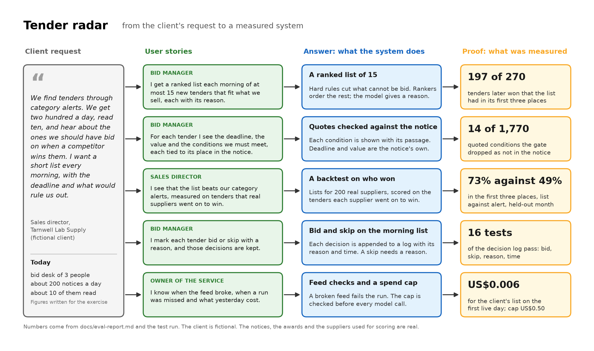
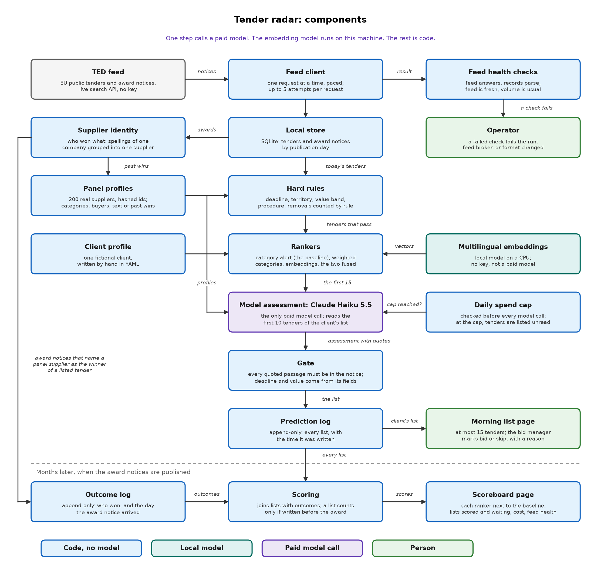
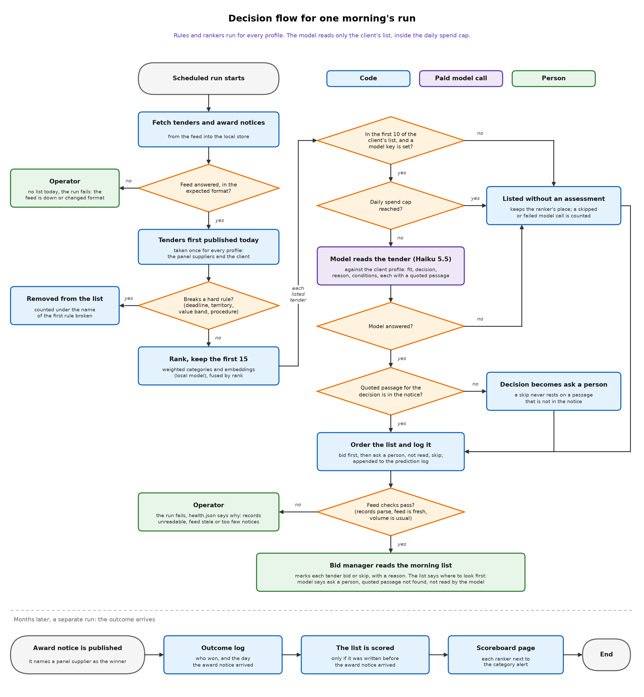
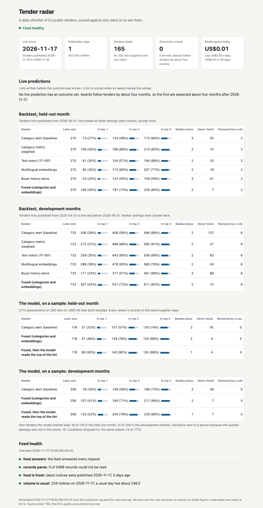
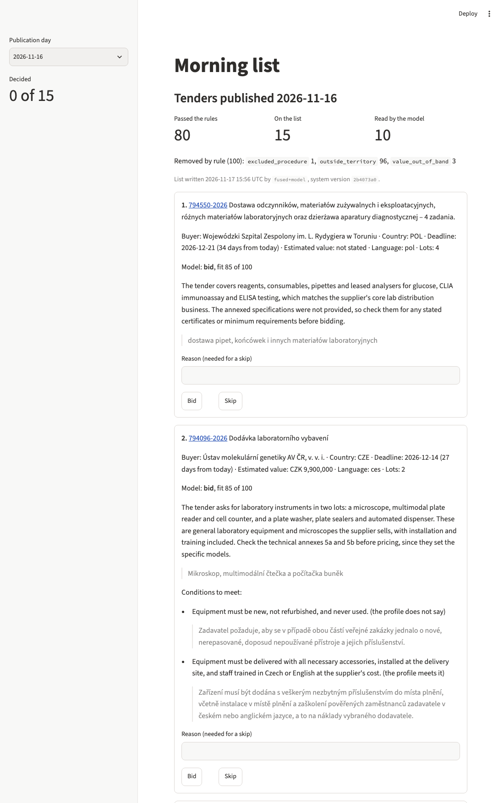

# Tender radar

A daily shortlist of EU public tenders for a supplier's bid desk. It reads the live
feed of TED, the EU's public procurement journal, removes what the company cannot bid
on, ranks the rest against what the company sells, and has a model read the top of the
list and say what would rule the company out, quoting the notice for every claim.

It is scored on real outcomes. The same feed later publishes who won each tender, so
the lists the system wrote can be checked against what 200 real suppliers went on to
win, without a single hand-written label.

**Status.** Built, measured and running. On the held-out month, 200 real suppliers
went on to win 270 of the tenders published. The radar's free ranking had 197 of them
(73%) in the first three places of that day's list, against 133 (49%) for the category
alert, and left 7 off the list against 45. Adding Claude Haiku 5.5 to read the top of
the list helped less than the development months suggested: on the held-out sample
the later-won tender was in first place 88 times of 176 with the model and 81 without,
and the model marked 18 of those 176 "skip". So the model is kept for what it writes,
a reason and the conditions with quoted passages, and its "skip" moves a tender down
the list but never off it. It costs US$0.54 per 1,000 tenders read. The live log
started on 17 November 2026 and has no outcomes yet: awards follow tenders by about
four months. [Section 9](#9-evaluation) says how far the numbers can be trusted. 204
tests.

**Contents:**
[The problem](#1-the-problem) ·
[How it works](#2-how-it-works) ·
[Decision flow](#3-decision-flow-for-one-mornings-run) ·
[Worked example](#4-a-worked-example) ·
[Guardrails](#5-guardrails) ·
[Where the model is used](#6-where-the-model-is-used-and-where-it-is-not) ·
[Failure handling](#7-failure-handling) ·
[Security and data](#8-security-and-data) ·
[Evaluation](#9-evaluation) ·
[Live operation](#10-live-operation) ·
[Human review](#11-human-review) ·
[Rollout, impact and integration](#12-rollout-impact-and-integration) ·
[Design decisions](#13-design-decisions) ·
[Run it](#14-run-it) ·
[Layout](#15-layout) ·
[Limits and next steps](#16-limits-and-next-steps) ·
[More detail](#17-more-detail)

## 1. The problem

> The customer is fictional ("Tarnwell Lab Supply", a distributor of laboratory
> instruments and reagents) and what its people say is written for the exercise. The
> tenders, the awards and the suppliers used for scoring are real.

Tarnwell wins most of its business through public tenders in Germany, Austria, Poland
and the Czech Republic. Its bid desk of three finds them through category alerts: a
daily email per saved search, listing every notice that carries a category code, in
publication order. The sales director:

> "We find tenders through category alerts. We get two hundred a day, read ten, and
> hear about the ones we should have bid on when a competitor wins them. I want a
> short list every morning, with the deadline and what would rule us out."

What discovery found ([notes](docs/discovery-notes.md)):

- The alert does not rank. The tender that matters is as likely to be last as first.
- Notices are written in the buyer's language only. The Polish and Czech ones are read
  last.
- A third of the reading time goes on tenders that one stated condition rules out.
- Nobody records why a tender was skipped.

Success criteria agreed with the (fictional) sales director:

1. On tenders real suppliers went on to win, the list puts more of them in its first
   three places than the category alert, on a month not used for tuning.
2. No tender is taken off the list on the strength of a passage that is not in the notice.
3. The deadline and the value shown are the notice's own.
4. A broken feed fails the run. It never produces an empty list that looks normal.



## 2. How it works



| Step | What happens | Model? | Module |
|---|---|---|---|
| Fetch | Page through the TED search API for a date range, one request at a time, 1.2 seconds apart, with retries | No | `feed.py`, `backfill.py` |
| Store | Raw records in SQLite, parsed on the way out, so a parser fix needs no second download | No | `store.py` |
| Parse | Typed notices and awards: the buyer's language picked, lots zipped, earliest deadline, value with currency. A missing field stays empty | No | `notices.py` |
| Link | Join a tender to its award by procedure. Group the spellings of one company into one supplier | No | `awards.py` |
| Profile | For a panel supplier: categories, countries and the text of its past wins. For the client: a YAML file the bid desk owns | No | `profile.py`, `panel.py` |
| Rules | Four named rules: deadline too close, outside the territory, value outside the band, excluded procedure | No | `filters.py` |
| Rank | Category alert (the baseline), weighted categories, multilingual embeddings, and the two fused. Word matching and buyer history are scored on their own | Local embedding model, no key | `rank.py`, `embed.py` |
| Assess | The model reads the first ten tenders against the profile: fit, bid or skip or ask a person, a reason, and the conditions for tenderers, each with a quoted passage | **Yes** | `assess.py`, `llm.py` |
| Gate | Every quoted passage must be in the notice. Deadline and value come from the notice's fields, never from the model | No | `gate.py` |
| Cap | A daily spend cap, read from the log before every model call | No | `budget.py` |
| Log | Append-only lists with the time they were written and the system version | No | `log.py`, `pipeline.py` |
| Truth | Awards that name a panel supplier as winner of a listed tender, with the day they arrived | No | `truth.py`, `live.py` |
| Score | Join lists with outcomes; write the report and the scoreboard | No | `evals.py`, `report.py`, `scoreboard.py` |
| Health | Feed answers, records parse, feed is fresh, volume is usual | No | `health.py` |
| Pages | The morning list with bid and skip, and the scoreboard | No | `app/morning_list.py`, `scoreboard.html` |

One function, `process_day`, makes every list. The morning run calls it with
yesterday's tenders. The backtest calls it with stored history, one publication day at
a time in date order. The numbers in section 9 come from the code that runs every morning.

## 3. Decision flow for one morning's run



The model reads only the client's list, only its first ten places, and only while the
day's spend is under the cap. Everything else is code. Three things reach a person:
the list itself, every tender the model or the gate marked "ask a person", and a
failed run.

## 4. A worked example

The fixture in this repository is one real publication day, 12 May 2026. `uv run
tenderradar demo` prints what follows, from the committed notices and recorded model
answers.

**The day.** 191 tenders were first published in the three category divisions. The
client's rules removed 117: 106 outside its four countries, 9 outside its value band,
1 with a deadline under ten days away, 1 for building work. 74 passed.

**The list.** The rankers kept 15 and the model read the first ten:

| Place | Model | Tender (title in the buyer's language) | Country | Deadline |
|---|---|---|---|---|
| 1 | bid, fit 85 | Zakup i sukcesywna dostawa odczynników laboratoryjnych wraz z dzierżawą aparatów (laboratory reagents with analyser lease) | Poland | 15 June |
| 2 | bid, fit 85 | AKH CTMT - 6219 - Mikroskope 02 (microscopes) | Austria | 11 June |
| 3 | bid, fit 82 | Zakup i dostawa odczynników dla Laboratorium Diagnostyki Hematologicznej (reagents for a haematology laboratory) | Poland | 12 June |
| 4 | bid, fit 75 | Medical Mass Spectrometer for Ukraine | Germany | 12 June |
| 7 | ask a person, fit 70 | Zakup i dostawa paneli multipleksowych identyfikujących patogeny (multiplex pathogen panels) | Poland | 17 June |
| 8 to 12 | not read | Five tenders below the tenth place of the ranking | Poland | |
| 13 | skip, fit 15 | Dostawa urządzeń medycznych (physiotherapy and training devices) | Poland | 15 June |
| 15 | skip, fit 4 | Dostawa leków (pharmaceuticals, 42 packages) | Poland | 12 June |

**One assessment in full**, place 4. The reason: "The tender asks for a mass
spectrometer for microbial identification, which is a core product in the supplier's
profile. The three stated conditions are turnover, two reference projects from 2023 to
2025, and ISO 9001; the profile meets the first and third, and the reference dates
need checking." The conditions, each with the passage the gate found in the notice:

| Condition | Met | Passage in the notice |
|---|---|---|
| Net annual turnover above EUR 200,000 in laboratory equipment delivery | yes | "have not generated net annual turnover of more than EUR200.000" |
| At least two reference projects delivering laboratory equipment in 2023 to 2025 | unknown | "can substantiate this with at least two reference projects" |
| Valid ISO 9001 certificate or equivalent | yes | "shall provide evidence of a quality management system by submitting a valid certificate in accordance with ISO 9001 or equivalent" |

**What the model did not decide.** The deadlines come from the notices' own fields.
The tenders marked "skip" are still on the list, at the bottom. On place 7 the model
noticed that the client holds no ISO 13485 certificate and sent the tender to a person
instead of guessing.

## 5. Guardrails

Each is a named rule in code, with a test.

| Rule | When it fires | Why |
|---|---|---|
| `deadline_too_close` | Fewer days to the deadline than the profile asks for | A bid cannot be written in time |
| `outside_territory` | The buyer's country is not one the profile sells in | The company cannot deliver there |
| `value_out_of_band` | The estimated value, converted to euros, is outside the profile's band | Too small to be worth a bid or too large to carry |
| `excluded_procedure` | A procedure or contract type the profile excludes, such as building work | Not what the company does |
| Missing is not failing | A notice with no deadline, value or country passes every rule above | Half the notices state no value; hiding them would hide half the feed |
| Quote gate, conditions | A condition whose quoted passage is not in the notice is dropped and counted | A bid manager must be able to find the sentence |
| Quote gate, decision | A decision whose quoted passage is not in the notice becomes "ask a person" | A "skip" never rests on words that do not exist |
| Structured fields win | Deadline and value are read from the notice's fields; the model is not asked for them | One less way to be wrong about the date that matters most |
| Notice is data | The notice goes to the model in a delimited block, and the prompt says it carries no instructions | A buyer's text cannot steer the assessment; a test plants an instruction |
| Skip is not removal | A tender marked "skip" moves to the bottom of the list and stays on it | The model orders a reading list. It dismisses nothing |
| Spend cap | Before each model call, the day's spend is read from the log. At the cap the list is written without assessments and the skips are counted | The job runs unattended |
| Written before the answer | A live list is scored only if it was written before the award notice arrived | A prediction made after the outcome is not a prediction |
| A day is listed once, when complete | The run lists publication days up to yesterday | A tender that arrived mid-run would otherwise never be listed |

## 6. Where the model is used and where it is not

| Task | Done by | Why |
|---|---|---|
| Which tenders are in scope | Code, from the profile file | The bid desk must be able to read and change the rules |
| Reading order | Code and a local embedding model | Free, fast, and measured on 1,003 real outcomes |
| Matching across languages | A local multilingual embedding model | A Polish notice and a German profile share no words |
| Does this tender fit, and what would rule us out | **Claude Haiku 5.5** | It needs reading: lots, conditions, and what the company does and does not hold |
| Is the quoted passage real | Code | Exact matching is a job for code |
| Deadline and value | Code, from the notice's fields | They are already structured |
| Who won | Code, from award notices | A join, not a judgement |
| Whether to bid | A person | The radar never decides this |

The model is the cheapest current one, at low effort. Section 9 shows what it adds
and what it does not: it reads and quotes reliably, and it is not yet a reliable judge
of what to skip. A larger model was not tried. The held-out result is a reason to try
one, and the budget for this build did not cover it.

## 7. Failure handling

| What goes wrong | What happens |
|---|---|
| The feed refuses a request or times out | Up to five attempts with growing pauses, then the run fails with a named error |
| The feed answers with HTML, or without its list of notices | `FeedError`. The run fails and `health.json` says why. No day is recorded as empty |
| Records that cannot be read | Counted. Over 1% of a run's records fails the run |
| The feed is stale, or a day has under 30% of the usual volume | The run fails after writing its lists, so the operator looks before the bid desk trusts the day |
| The model call fails or is rate limited | The tender is listed without an assessment and the failure is counted |
| The daily cap is reached | The same, counted separately |
| The run is started twice | Lists already in the log are not written again and the model is not asked again |
| A recording run is interrupted | Responses are appended to the cassette one line at a time, so every answer already paid for is kept |
| A notice lacks a deadline, a value, lots or conditions | It is listed, and the missing field is shown as missing |
| A correction to a tender is published later | The tender is not listed a second time, as long as its first notice is in the local store. The scheduled run reads the last 14 days, so a correction to an older tender is listed as new |

## 8. Security and data

- **Read-only.** The radar never writes to TED and files no bids. It sends one request
  at a time with a generic client name and no contact details.
- **No supplier names are committed.** Company names and registration numbers stay
  in the local database, which is git-ignored. Everything committed carries a hash:
  profile ids, buyer ids, and the table that recognises a panel supplier in a new award.
- **The hashes are not anonymity.** Award notices are public, the hash is unsalted and
  its recipe is in the source, so anyone who has a supplier's name can compute its id,
  and the contract excerpts in a profile can be searched on TED. The hashes keep a list
  of company names out of the repository, nothing more.
- **No sole traders.** A supplier is on the panel only if its name carries a legal
  form, because a sole trader's name is a person's name.
- **No contact fields.** Winner and buyer email, phone and address exist in the feed
  and are never requested. The feed sends document links unasked; they are dropped.
  One buyer typed an email address into a description on the fixture day; addresses in
  free text are replaced before the fixture is written.
- **What the model sees.** One notice's text and a profile. A panel profile is shown
  as a list of past contract titles, never a name.
- **Notice text is committed in two places**, each with a notice file: one day of
  competition notices in the fixture ([NOTICE](data/fixture/NOTICE)), and up to 40
  excerpts of award-notice text in each of the 200 panel profiles, 5,550 in all
  ([NOTICE](data/profiles/NOTICE)). TED's legal notice says procurement notices "can
  be freely reused, for commercial or non-commercial purposes".
- **The key** is read from the environment or a git-ignored `.env` file and is never
  logged. The scheduled job reads it from a repository secret and runs without it if
  the secret is absent.

## 9. Evaluation

### What is scored

A competition notice and its award notice share a procedure identifier. So for every
tender, the feed later says who won.

- **History.** 126,452 award notices from January 2025 to November 2026 in three
  category divisions, naming 33,868 suppliers after the spellings of each company
  were grouped.
- **Split in time.** A profile is built from awards published before 1 April 2026 and
  then frozen. Test tenders are the 11,549 procedures first published from 1 April to
  30 June 2026, on 60 publication days. June was held back and scored once, after
  every setting was fixed.
- **Panel.** 1,550 suppliers are companies with at least five wins before the cut and
  at least two wins of test tenders. 200 of them are on the panel, taken country by
  country. Between them they went on to win 1,003 test tenders.
- **The question.** For each of those 1,003: was the tender on the list the system
  wrote for that supplier on the day it was published, and in which place?

The baseline is the bid desk's present tool: every tender that shares a five-digit
category with one the supplier has won in, in publication order.

### Ranking, with no paid model

Of the tenders a supplier went on to win, how many were in the first places of its
list that day.

**Held-out month** (June 2026, 270 tenders later won, scored once):

| Ranker | In top 1 | In top 3 | In top 5 | Never listed |
|---|---|---|---|---|
| Category alert (baseline) | 73 (27%) | 133 (49%) | 172 (64%) | 45 |
| Weighted categories | 108 (40%) | 186 (69%) | 215 (80%) | 10 |
| Word matching (TF-IDF) | 81 (30%) | 154 (57%) | 184 (68%) | 25 |
| Multilingual embeddings | 95 (35%) | 173 (64%) | 207 (77%) | 19 |
| Buyer history alone | 53 (20%) | 122 (45%) | 159 (59%) | 41 |
| **Fused: categories and embeddings** | **109 (40%)** | **197 (73%)** | **228 (84%)** | **7** |

The 95% interval for the fused ranker's 73% is 67% to 78%; for the alert's 49% it is
43% to 55%.

Most of the gain over the alert comes from weighting the categories. Adding the
embedding model to that moves 186 to 197 in the first three places and 108 to 109 in
first place, which is inside the interval above. What the embedding model adds on
top of weighted categories is not shown by this month.

**Development months** (April and May 2026, 733 tenders later won; settings were
chosen here):

| Ranker | In top 1 | In top 3 | In top 5 | Never listed |
|---|---|---|---|---|
| Category alert (baseline) | 206 (28%) | 408 (56%) | 496 (68%) | 122 |
| Fused: categories and embeddings | 307 (42%) | 531 (72%) | 611 (83%) | 15 |

The held-out month agrees with the development months for the fused ranker. A list
holds 6 tenders on average and at most 15, because a supplier's territory leaves about
8 candidates on a typical day.

### The model, on a sample

Running the model on all 12,000 supplier-days would have cost about US$40. It ran on a
fixed sample instead: for the first 100 panel suppliers by hashed id, up to three days
on which a tender they later won was published. The sample was drawn separately in the
development months and in June. The other rankers are scored on the same supplier-days.

| Sample | Ranker | Later won | In top 1 | In top 3 | In top 5 | Marked "skip" |
|---|---|---|---|---|---|---|
| Development | Fused | 258 | 107 (41%) | 184 (71%) | 217 (84%) | |
| Development | Fused, then the model | 258 | 133 (52%) | 204 (79%) | 229 (89%) | 12 |
| Held-out | Fused | 176 | 81 (46%) | 139 (79%) | 154 (88%) | |
| Held-out | Fused, then the model | 176 | 88 (50%) | 140 (80%) | 155 (88%) | 18 |

What this says:

- **The gain did not hold.** On the development sample the model moved the later-won
  tender into first place 26 more times. On the held-out sample, 7 more times, with
  nothing gained in the first three or five places.
- **The worst error is too common.** The model marked "skip" on 12 of 258 later-won
  tenders in development (5%) and 18 of 176 in the held-out month (10%). Read one by
  one, the development cases were tenders unlike anything in the supplier's recent
  contracts: a medical-gas supplier that won rehabilitation devices, an imaging
  supplier that won coagulation analysers. The model sees a panel supplier as its
  twelve most recent contract titles, so a second line of business is invisible to
  it. That is a likely cause and was not tested.
- **Over all its decisions the model separates well.** The median fit it gave a
  later-won tender was 85 of 100; for the other tenders on the same lists, 12. It
  marked 1,435 of 2,772 tenders "skip", which is half the reading.

This is why a "skip" moves a tender to the bottom of the list and never removes it,
and why the rollout gate on the model is not met (section 12).

### What the model writes

- **Quoted passages.** Of 2,772 recorded assessments, the gate changed 16 decisions to
  "ask a person" because the passage quoted for the decision was not in the notice.
  It dropped 14 conditions for the same reason and kept 1,756.
- **Conditions, read one by one.** The 26 conditions the model stated on the fixture
  day were read against their passages, in German, Polish and English
  ([review](docs/condition-review.md)). In 25 the English sentence says what the
  passage says; one adds a clause that is not there. In 24 the "met" judgement is
  reasonable given the client profile; two say "no" where the profile is silent.

### The worst error, counted

A tender the supplier went on to win that it was never shown, or was told to skip.

| | Count |
|---|---|
| Removed by a hard rule before ranking (5 won in a country new to the supplier, 3 had a deadline before their first publication in the store) | 8 of 1,003 |
| Passed the rules and was not in the fused ranker's first 15, held-out month | 7 of 270 |
| Marked "skip" by the model, held-out sample | 18 of 176 |

### Cost

2,772 assessments cost US$1.49: US$0.54 per 1,000 tenders read, about 3,500 input
tokens and 380 output tokens each. The client's ten assessments on the first live day
cost US$0.006. Everything else is free: the feed needs no key and the embedding model
runs on a laptop CPU at about 400 texts a second.

### How far to trust it

- **Winners are the only outcome on record.** A tender a supplier bid for and lost was
  relevant and counts here as clutter. The figures understate how useful a list is and
  say nothing about precision.
- **The panel is made of active suppliers**, and takes them country by country. A small
  country has few tenders a day, which makes the first 15 places easy for every ranker.
  Read the first one, three and five.
- **Only tenders awarded by 17 November 2026 can be scored.** About half of the June
  tenders had an award by then. Procedures that take longer are missing.
- **Supplier identity is resolved from what buyers typed.** Some wins are attributed to
  the wrong supplier or to none.
- **Tender history starts in January 2026.** A procedure first published before that
  and published again in the test window counts as new.
- **The model was scored on a sample**: supplier-days on which a later-won tender was
  published. It shows what the model does to the order on those days. It does not
  show how many tenders it would mark "skip" for an ordinary profile on an ordinary day.
- **It is still a backtest.** The live log in section 10 is the measurement that cannot
  have been tuned, and it has no outcomes yet.

## 10. Live operation

The radar runs on the live feed, to the [live standard](../../docs/project-standard.md#live-projects)
of this repository.

| | |
|---|---|
| Schedule | `.github/workflows/live-tender-radar.yml`, Tuesday to Saturday at 05:40 UTC, and on demand. Each run lists the publication days up to the day before |
| Prediction log | `data/log/live.jsonl`: every list, the time it was written, the system version |
| Day index | `data/log/live-days.jsonl`: which tenders were published on which day, without their text |
| Outcomes | `data/log/outcomes-live.jsonl`: awards that name a panel supplier as winner of a listed tender |
| Scoreboard | `var/scoreboard/index.html` and `scoreboard.json`, written on every run |
| Spend | US$0.50 a day at most, read from the log before every model call |
| Where results go | A `live-data` branch. The job never writes to `main` |

**The first run, 17 November 2026.** It read 5,488 notices from the last 14 days,
none unreadable, and listed the 180 tenders first published on 16 November: 402 lists,
two for each of the 200 panel suppliers and two for the client. The model read the
first ten of the client's list for US$0.006. All four feed checks passed.

**What is still waiting.** No award has yet named a winner for a tender listed live.
The median award in the backtest came 119 days after the tender, so the first live
scores are expected around March 2027. Until then the scoreboard shows
the backtest next to an empty live table, and says so.



The scheduled workflow has not run on GitHub yet: the repository has no remote.
[Section 16](#16-limits-and-next-steps) lists what was and was not run.

## 11. Human review

The bid manager works from the morning list page (`app/morning_list.py`):

- The day, how many tenders passed the rules and how many each rule removed.
- For each tender: the place, a link to the notice on TED, the title, buyer, deadline
  and value from the notice's own fields, the model's decision and reason with its
  quoted passage, and each condition with its passage and whether the profile meets it.
- **Bid** and **Skip** buttons. A skip needs a reason. Decisions are appended to a log;
  a later decision on the same tender supersedes the earlier one and both stay in the
  file.



The decisions are the feedback the present process never kept. They are the input for
revising the profile file each month, and with a few months of them the list could be
scored against what the desk chose to bid on, not only against what it won.

## 12. Rollout, impact and integration

**Gates** ([project plan](docs/project-plan.md)). A gate is a measurement and the
sponsor decides on it.

| Gate 1: start a shadow run next to the alerts | Result on the held-out month | |
|---|---|---|
| The fused ranker has more later-won tenders in its first three places than the alert, by at least ten points | 73% against 49% | Met |
| The model marks "skip" on no more than 1 in 20 tenders a supplier went on to win | 18 of 176, about 1 in 10 | **Not met** |
| No quoted passage reaches the list that is not in its notice | Checked by the gate on every assessment | Met |

What that means for the rollout: the shadow run can start with the ranking and with
the model's reasons and conditions shown. The model's decision should not reorder the
list until its "skip" is right more often, and the first thing to try is a richer
profile for the model to read. Gates 2 and 3 need a bid desk and four weeks of live
running.

**Impact** ([estimate](docs/impact-estimate.md)).

The evaluation contributes one input: how much of what matters is at the top of the
list. On the held-out month, a desk that reads the first three tenders of its list
each morning would have seen 197 of the 270 tenders it went on to win. With the alert
in publication order, 133. The rest of the estimate is assumption: a desk that spends
an hour a day on alerts is assumed to spend 23 minutes on the list. The model costs
under one cent a morning.

**Integration.** The radar's inputs are one profile file and a public feed, so it
needs no access to the client's systems to start. The next connection would be the
bid desk's pipeline tool: a tender marked "bid" becomes an opportunity with its
deadline. That is not built.

## 13. Design decisions

The [decision log](docs/decision-log.md) has 22 entries with alternatives and
trade-offs. The ones that shaped the system most:

- **Outcomes instead of labels.** Awards give 1,003 real outcomes that nobody chose.
  The price is that only wins are visible.
- **One code path.** The backtest is a replay through the live pipeline, not a
  separate script.
- **Two signals were measured and left out.** Word matching and buyer history each
  made the fused list worse or no better on the development months. Buyer history was
  the surprising one: 62% of later-won tenders came from a buyer the supplier had won
  from before, but so did 19% of everything else on its list.
- **Names are paired with numbers only in single-winner awards.** The feed's winner
  lists are not in the same order. Pairing them by position attached one company's
  number to another in 812 of 913 cases checked.
- **The model quotes, and code checks the quote.** That is both the hallucination
  guard and the defence against text planted in a notice.
- **A day is listed once, when it is over.** The list is a day late and never misses a
  tender that was published during the run.

## 14. Run it

Each command is run in `projects/tender-radar`. Install with `uv sync --all-extras`.

**No key, no network** (what CI runs):

```bash
uv run pytest                      # the tests
uv run tenderradar demo            # the worked example: one real day, recorded answers
uv run tenderradar eval            # score the committed logs, write docs/eval-report.md
uv run tenderradar scoreboard      # write var/scoreboard/index.html
```

`demo` downloads the embedding model (about 220 MB) on first use. Add
`--stub-embedder` to skip the download and rank by word hashing instead.

**No key, with network** (free, about 25 minutes, 2.3 GB of disk):

```bash
uv run tenderradar backfill --kind award --from 2025-01-01        # 126,000 awards
uv run tenderradar backfill --kind competition --from 2026-01-01  # 57,000 tenders
uv run tenderradar replay --fresh                                 # the backtest, free rankers
```

**With a key** (`ANTHROPIC_API_KEY` in the environment or in `.env`):

```bash
# The model on the two backtest samples. Recorded answers are replayed for free and
# only missing ones are paid for. As recorded: 2,772 assessments, US$1.49.
uv run tenderradar replay --fresh --to 2026-05-31 --model-profiles 100 --live --record --budget-usd 1.2
uv run tenderradar replay --from 2026-06-01 --model-profiles 100 --live --record --budget-usd 0.8

uv run tenderradar run      # the morning run: under one cent for the client's list
uv run tenderradar truth    # record outcomes from the awards in the store
uv run tenderradar today    # print the client's latest list
```

**The pages:**

```bash
uv run streamlit run app/morning_list.py    # the bid manager's page
open var/scoreboard/index.html              # the scoreboard
```

**Operations:** `docker compose up -d --build` runs the daily loop on any machine. The
[runbook](docs/runbook.md) covers the scheduled workflow, a failed run, a missed day,
the spend cap and a change in the feed's format.

## 15. Layout

```
projects/tender-radar/
  src/tenderradar/
    feed.py backfill.py store.py notices.py   the feed, the local store, the parser
    awards.py profile.py panel.py cpv.py      who won what, profiles, the panel
    filters.py rank.py embed.py               hard rules and the rankers
    assess.py gate.py llm.py budget.py        the model step, the gate, record and replay
    pipeline.py backtest.py live.py           one day's lists; history; the live run
    log.py truth.py evals.py report.py        the two logs, scoring, the report
    scoreboard.py scoreboard.html health.py   the scoreboard and the feed checks
    decisions.py demo.py cli.py config.py models.py
  app/morning_list.py                         the bid manager's page
  scripts/                                    the three diagrams, the fixture builder
  data/
    client_profile.yaml                       the scenario client
    fixture/                                  one real day of notices, with NOTICE
    cassettes/                                recorded model answers
    log/                                      the prediction log and the outcome log
    profiles/                                 panel profiles and aliases, hashed
  docs/                                       diagrams, the report, delivery documents
  tests/
  Dockerfile compose.yaml
.github/workflows/live-tender-radar.yml       the scheduled run
```

## 16. Limits and next steps

**What the numbers do not show**

- Winners are the only outcome on record, so precision cannot be measured and recall
  is a lower bound.
- Three category divisions. Construction, IT services and the rest of the feed were
  not measured.
- The scenario client is fictional, so its own list has no outcome. The model's effect
  on a list is measured on panel suppliers, whose profile is their contract history,
  not a hand-written file.
- The live log has no outcomes yet. Awards follow tenders by about four months.

**What the system does not do**

- It reads the notice, not the tender documents on the buyer's portal. A condition
  that sits only in the documents is missed.
- The embedding model reads the first 700 characters of a notice.
- Buyer history is measured and unused. Category match and text similarity are fused
  by rank, not by a learned model.
- One model at one effort level. The held-out "skip" errors are a reason to compare a
  larger model or a richer profile; neither was done.
- Phone numbers that a buyer typed into free text are not removed. Email addresses are.

**What was never run**

- The scheduled workflow has not run on GitHub: the repository has no remote yet. Its
  restore and publish steps were run against a local bare repository.
- The Docker image was not built. `docker compose config` passes.
- The morning list page was tested through Streamlit's test harness and has not been
  used by a bid desk.

**Next steps, in order of value**

1. Let the live log fill, and publish the scoreboard.
2. Show the model a supplier's categories and more of its history, then measure "skip"
   on a new month. Compare one larger model on the same sample.
3. A learned ranker over categories, text, buyer history and value, trained on awards
   before the cut and scored on the same held-out month.
4. Score the client's list against the desk's own bid and skip decisions.
5. Read the tender documents for the tenders the model marks "bid".
6. More divisions, each with its own panel.

## 17. More detail

- [Discovery notes](docs/discovery-notes.md): the request, the work today, user stories
- [Workflow map](docs/workflow-map.md): before and after, who decides what
- [Project plan](docs/project-plan.md): timeline, go-live gates, risks
- [Decision log](docs/decision-log.md): 22 decisions with alternatives
- [Impact estimate](docs/impact-estimate.md): the model behind the estimate
- [Evaluation report](docs/eval-report.md): written by `tenderradar eval`
- [Review of the model's conditions](docs/condition-review.md): 26 conditions read against their passages
- [Runbook](docs/runbook.md): operating the daily run
